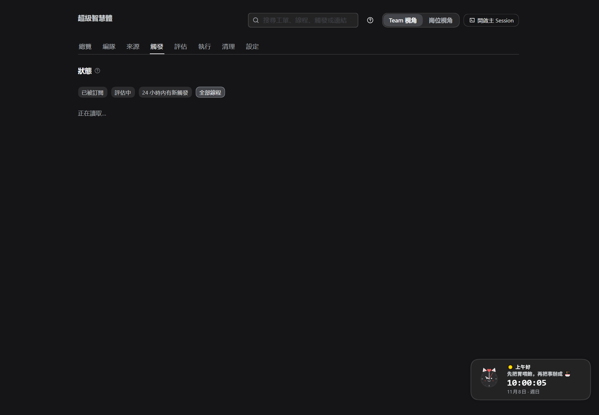
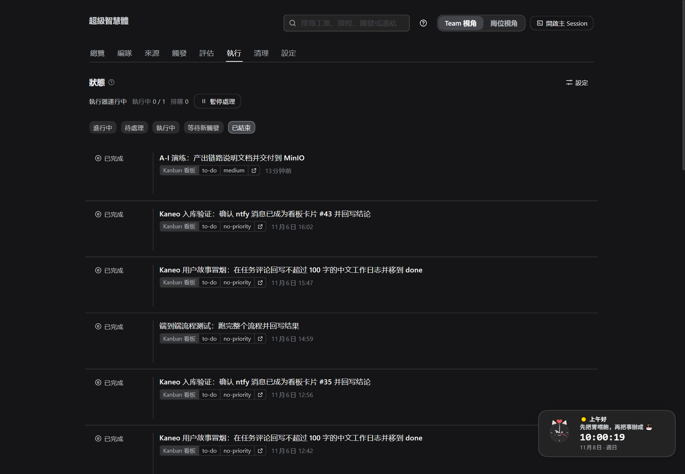
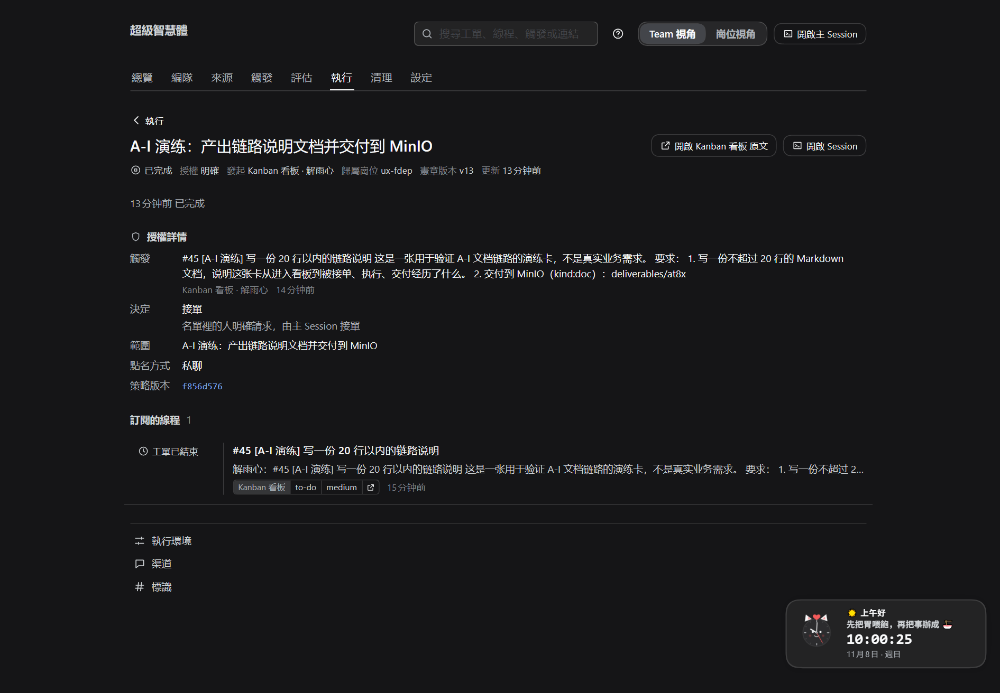
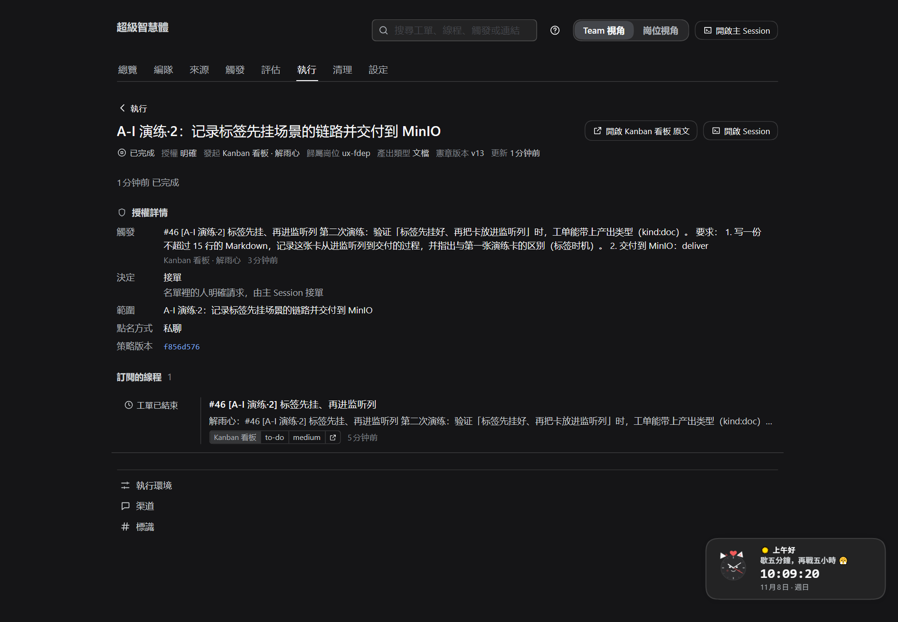

# A-I · 从准备到交付：一个项目的一整条流水线

> **这份文件做什么**：把 [ABC.md](ABC.md)（准备）、[DEF.md](DEF.md)（需求 → 工单）、[GHI.md](GHI.md)（执行 → 交付）串成一条线，用 **A–I 九节**讲完一个项目从零到交付的完整一轮，并在最后附上**本机真实跑过的演练卡**（截图 + 时间 + 数字）。
> **给谁看**：第一次接手的人（PM 20 分钟通读）；任何人想确认"现在卡在哪一步"时按节查。
> **前提**：本机设置检查全绿（ABC）。文中所有"事实"都来自当前部署与代码；演练数据见 §11。
> **分册**：需要细节时看对应长文——[ABC.md](ABC.md) · [DEF.md](DEF.md) · [GHI.md](GHI.md) · [SOP.md](SOP.md) · [AIOS.md](AIOS.md)；宪章仓库的能力供给与 PM 运营职责见 [EA.md](EA.md)。
> 演示稿：[A-I.html](A-I.html) · [A-I.pdf](A-I.pdf)；分册演示稿：[ABC.html](ABC.html) · [DEF.html](DEF.html) · [GHI.html](GHI.html)。

---

## 0. 30 秒看懂：一条流水线，九个阶段

```text
A 准备环境 ─▶ B 登记项目/岗位/宪章/职责 ─▶ C 触发 ─▶ D 评估/路由 ─▶ E 闸门 → 工单
                                                                        │
                          I 交付与部署 ◀─ H 异常处置 ◀─ G 反馈 ◀─ F 执行 ◀┘
```

| 阶段 | 一句话 | 主要产物 | 在哪看 |
| --- | --- | --- | --- |
| **A 准备** | 四张来源卡接通、八项自检全绿 | 可运行的环境 | 设置 → 来源 / 设置检查 |
| **B 登记** | 项目、本机岗位、宪章、职责（一位一文件） | 本机 Team + 规则 | 设置 → 项目与岗位 |
| **C 触发** | 卡进监听列 / 消息到达，系统"看见" | 触发 + 线程 | 触发页 |
| **D 判断** | 看板卡直接路由；聊天候选按规则评估 | 决定（接单/忽略/未完成） | 评估页 |
| **E 闸门** | 宪章 → PM → 职责 → 岗位承接，全过才建单 | 工单 | 执行页 / 工单页 |
| **F 执行** | 派工、工作目录、按提示词干活 | 交付物草稿、工作记录 | 工单页 / 编队页 |
| **G 反馈** | 五种报告 → 卡片评论 / 列移动 / 面板 | 进度与结果 | 工单页 / 卡片 |
| **H 异常** | 待回答/待验收/受阻/失败/未送达…对号入座 | 处置记录 | 工单页 / 异常队列 |
| **I 交付** | PR / MinIO / 评论；验收后结束 | 可验收的成果 | 卡片 / MinIO / 清理页 |

**贯穿全局的一条铁律**：**没有宪章不开工**；**职责必须先定义**；**岗位必须承接**；**PM 默认不执行工人职责**。四道闸门都在主机侧，提示词和卡片都改不动。

---

## 1. 一条真实的时间线（先看结果，再看过程）

本机 2026-11-08 上午跑了两张演练卡（现在还在看板 `done`，可点开对照）：

| 时刻（+08） | 发生了什么 | 证据 |
| --- | --- | --- |
| 09:45:39 | 建卡 #45 到 `to-do`，负责人 = 前端岗位（解雨心） | 看板卡 #45 |
| 09:46:02 | 决定 = **接单**（理由：名单里的人明确请求，由主 Session 接单） | 评估页 |
| 09:46:05 | 派工开始（会话 `worker-f0521424…`、工作目录已建） | 工单页「派工历史」 |
| 09:47:11 | MinIO 写入 `rehearsal.md`（1810 字节）并回读 | MinIO `ateam` |
| 09:47:27 | 报告 `ready` → 工单结束（completed） | 工单页 |
| 09:47:34 | 卡片评论回写 `bucket/key` + 结论 | 看板 #45 评论 |

**总耗时约 1 分 48 秒**，全程没有人工点过"接单/派工"按钮——这正是 A–I 流水线该有的样子。

---

## 2. A · 准备环境（ABC 的浓缩）

**用户视角**：把四个"家"接上，让面板替你说"现在就绪"。

| 要接的 | 填什么 | 本机状态 |
| --- | --- | --- |
| 看板（Kanban） | 服务器、API key、项目、监听列 `to-do` | ready |
| 宪章仓库（Gitea） | 服务器、账号、仓库 `owner/name`、文件 `README.md` | ready |
| 通知（ntfy） | 服务器、topic（建议入库 tag `dsh`） | ready |
| 文件柜（MinIO） | 服务地址、桶（`ateam`），密钥可留空 | ready |

**看到什么算 OK**：设置检查 8 项全绿；四张来源卡没有红色报错。
**为什么重要**：后面每一节都假定这四个家已通；任何一项红，C–I 都会静默停住。

---

## 3. B · 登记：项目、本机 Team、宪章、职责

**用户视角**：告诉系统"这个项目、这台机器演谁、按什么规矩、有哪些活法"。

| 登记项 | 本机现状 | 要点 |
| --- | --- | --- |
| 项目 | `Superagent`（`at8xrho45bisco2umjzgl1xp`） | 下拉选，不手抄 id |
| 本机岗位 | `ux-fdep`（前端，解雨心）、`api-fdep`（后台，高洁） | **本机 Team = 这台机器演的岗位组合**；同一岗位不要两台都登记 |
| 宪章 | v13（`shawoo/rsi_superagent/README.md`） | 每周最多一版；流程、交付标准、PM 授权都写这里 |
| 职责 | `duties/` 目录，一位一文件：`ui`→ux-fdep、`api`→api-fdep、`doc`/`req-analysis`→pm-rsi | 岗位卡用「接哪些职责」下拉绑；**职责文件里的承接岗位是兼容写法** |

**看到什么算 OK**：岗位卡显示"已映射为 Kanban 账号：邮箱"；职责列表条数对；宪章版本 ≥ v1。

> **宪章仓库不只是规则**：除 `duties/`，还承载 `reviews/`（日/周/月复盘）、`context/`（复盘总结 / 领域对象 / 组织本体）、`KE/`（P/A/R/T + MAKE 知识库）、`skills/`（技能生命周期）五层能力资产，加上契约层（`README` / `CAPABILITY`）共六层；落地路线与 PM 运营职责见 [EA.md](EA.md)。
**注意**：`doc`/`req-analysis` 仍写着承接岗位 `pm-rsi`，但本机当前没有 PM 岗位——它们暂时无人承接，等 PM 岗位加回来或改绑定（这是数据现状，不是故障）。

---

## 4. C · 触发：系统"看见"了需求

**用户视角**：把卡放进监听列，一分钟内系统应该"看见"。

- 看板来源每 **60 秒** 轮询一次；卡进入监听列、发起人（负责人或创建者）在名单里 → 生成**触发**；一张卡 = 一个**线程**。
- **标签要在卡进入监听列之前挂好**：`duty:`、`kind:`、`repo:` 都在触发那一刻读取；后挂会缺席（§11 的演练 #45 就是这样，工单没带上产出类型）。
- 聊天来源（如飞书）的消息也会成为触发；本机 ntfy 消息会**先入库成看板卡**，所以走的是看板卡这条路。

**在哪看**：触发页（已被订阅 / 评估中 / 24 小时有新触发 / 全部线程）；看不到就查「来源」页 24 小时统计与过滤原因。

---

## 5. D · 判断：接，还是不接

**用户视角**：看板卡是"人已经决定要干"的请求，不需要模型再判断；聊天里推断出来的候选才需要评估。

| 需求从哪来 | 处理 | 面板记录 |
| --- | --- | --- |
| 看板卡（含 ntfy 入库卡） | **显式请求** → 直接**接单路由** | 接单（理由：名单里的人明确请求） |
| 聊天 · 名单内点名 | 显式请求 → 路由 | 接单 |
| 聊天 · 名单内没点名 | **推断候选** → 按规则评估（四问：是否实现请求 / 目标是否明确 / 是否要设计决定 / 证据） | 接单 / 忽略 / 未完成 |
| 聊天 · 名单外 | 策略层过滤 | 来源页显示原因 |

**接单模式**（关闭 / 仅观察 / 自动接单）**只影响推断候选**；看板卡在任何模式下都会进入闸门。本机当前是「仅观察」，所以聊天推断只会记录"可接单"，但看板卡照常建单（§11 已验证）。
**在哪看**：评估页，按「接单与续做 / 停止 / 忽略 / 未完成 / 全部」筛选；每条都有理由。

---

## 6. E · 闸门与工单：能不能干、干成什么

**用户视角**：接单不等于开工，还要过四道闸门；过了才变成一张有授权、有归属的工单。

| 闸门（按检查顺序） | 不过时 | 怎么修 |
| --- | --- | --- |
| 项目已发布宪章 | "这个项目还没有发布宪章，不能开工" | 发布宪章 |
| PM 不执行工人职责 | "PM 岗位默认不执行工人职责…" | 改派 Worker；或在宪章写 `PM 可执行职责` |
| 职责已定义 | "卡片声明的职责在职责说明里没有定义" | 在 `duties/` 加这个 `duty:<id>` |
| 岗位承接该职责 | "这个职责由别的岗位承接" | 岗位卡下拉选中它 |

**工单上有**：标题/范围、授权（强度·发起人·决定·规则·政策版本）、归属岗位（WIP 按它算）、职责简报（有 `duty:` 时）。
**在哪看**：执行页（进行中/待处理/执行中/等待新触发/已结束）、工单页。

---

## 7. F · 执行：谁在干、在哪干、按什么干

**用户视角**：系统自己开一个"工人"，给它一个专属目录和一份说明书。

- **派工**：按并行工单数领活 → 建 `worker-<工单 id>` 会话 → 工作目录 `<短名>-<工单 id 前 12 位>` → 派工消息（范围 + 规则 + 职责简报）。
- **准备命令**：目录不存在时跑一次（10 分钟，`sh`），常用 `git worktree`；失败=工单失败，**空的残留目录会被删掉**，所以重试会重跑；如果它留下了非空目录，重试会当成"已准备好"——先手动清理再重试。
- **提示词五层**（硬约束 → 内置+生成 → 规则 → 团队小节/技能 → 外部文本）：
  - 团队三节：**沟通方式 / 工单范围 / 交付要求**；内置段落可覆写；技能按需加载。
  - 改提示词**不重启**，下一次模型请求生效；但改不了工具校验、授权和闸门。
- **执行器读什么**：派工说明、宪章（第一步读并报版本）、仓库 `AGENTS.md`；人发的消息直达该工单，超范围就交还。

**本机执行设置**（当前）：模型 `aife/MiniMax-M3.1-Flash`、并行 1、执行目录默认、无准备命令、无禁止命令。

---

## 8. G · 反馈：进度和结果怎么回来

**用户视角**：不用盯 Session，工单页和卡片会告诉你到哪一步。

| 报告 | 含义 | 面板 | 卡片/消息 |
| --- | --- | --- | --- |
| progress | 还在干 | 执行中 | 内部；答人问题时会带出去 |
| ready | 可验收 | 待验收（有 PR）/ 直接完成（无 PR） | 结果评论 |
| blocked | 缺前置 | 待处理受阻 | 写清卡点 |
| failed | 执行失败 | 待处理失败 | 记录错误（网络类先自动重试 3 次） |
| dropped | 无需处理 | 已结束 | 静默 |

**卡片谁来写**：执行器只报告；**宿主**写卡片评论、把卡从认领列移到交付列、通知人。
**工单页能看到**：授权详情、未送达的输入、订阅的线程、派工历史（含每次报告）。
**本机实测**：`ux-fdep` 的演练工单报告 `ready` 后 7 秒内，卡片评论出现 `bucket/key`，卡列从 `in-progress` 到 `done`（§11）。

---

## 9. H · 异常：卡住了按状态对号入座

| 你看到的 | 含义 | 你做什么 |
| --- | --- | --- |
| 排队中 | 等并行名额 | 等；或调大并行数 |
| 待回答 | 它提了一个具体问题 | 在卡片/线程回答 |
| 待验收 | 做完了等人看 | 看结果/PR；合并或确认 |
| 待处理受阻 | 缺权限/凭据/信息 | 补上后回消息，或重试 |
| 待处理失败 | 启动/执行出错 | 修好后重试（同会话/目录/PR 继续） |
| 输入未送达 | 消息没送到 | 自动重试；仍失败可手动重试 |
| 等待新触发 | 本轮干完 | 线程新消息会唤醒 |
| 已结束 | 完成/合并/关闭/停止/无需处理 | 看结果；按需清理 |

**兜底**：暂停处理（不派新活、不回复；正在跑的回合不打断）、停止工单（保留会话目录、收回授权）、直接进 Session 接手、重启后带恢复说明重开。

---

## 10. I · 交付与部署：成果放在哪、怎么收尾

**用户视角**：结果必须落在"能验收的地方"，卡片只是指针。

| 产出类型 | 载体 | 回写 |
| --- | --- | --- |
| `kind:code` | 代码 PR（`repo:owner/name`） | PR 链接 + 评审状态 |
| `kind:doc` / `plan` / `memo` / `log` | MinIO：`deliverables/<项目 id>/<工单 id>/<文件>`，写完回读 | `bucket/key` + 一句摘要 |
| 其他 | 卡片评论（追加） | 结论 + 状态推进 |

**交付完成的判定**：有 PR → ready 待验收，PR 合并/关闭后结束；无 PR → ready 直接完成；半成品只能 blocked 并写清草稿位置。
**部署与收尾**：部署页确认状态目录与部署检查；升级后工件/会话/设置保留；清理页处理已结束职责的工作区（默认不删目录，Session 日志不删）。

---

## 11. 真实验证：演练卡 #45 与 #46（带截图）

> 下面全部是本机 2026-11-08 上午真实发生的事。卡 #45、#46 现在还在看板 `done`，可点开核对评论与时间。

### 11.1 演练 #45：完整跑通一遍（标签后挂）

**卡**：#45 · 「[A-I 演练] 写一份 20 行以内的链路说明」· 负责人 解雨心（前端岗位）· 标签 `kind:doc`（**建卡后才挂**）· 建卡 09:45:39。

| 环节 | 数据 |
| --- | --- |
| 触发/线程 | `kaneo:jdxt1v33t11y4vhpyu3lbbpu`，1 条触发 |
| 决定 | **接单**，理由 `explicitRouted`（09:46:02） |
| 工单 | `f052142455eae13bf96be4334c0029a0`，归属岗位 `ux-fdep`，强度 explicit |
| 派工 | 09:46:05 开始；工作目录与会话已建 |
| 报告 | `ready`（09:47:27）；工单结束 completed |
| 交付物 | `ateam/deliverables/at8xrho45bisco2umjzgl1xp/f052142455eae13bf96be4334c0029a0/rehearsal.md`，1810 字节，已回读 |
| 卡片 | `to-do → in-progress → done`；2 条评论：确认 + `bucket/key` 结论 |
| 耗时 | 建卡 → 结束 **1 分 48 秒** |



*图 1：触发页。演练卡进入监听列后成为线程，触发可按线程查看。*


*图 2：评估页。看板卡被记为"接单 · 名单里的人明确请求，由主 Session 接单"。*



*图 3：执行页（筛选「已结束」）。演练工单在列表里，可点开。*


*图 4：演练工单的授权详情、归属岗位。*



*图 5：往下是未送达的输入、订阅的线程与派工历史；摘要里有 MinIO 的 `bucket/key`。*

### 11.2 演练 #46：标签先挂、再进监听列（对照实验）

**动机**：#45 的标签是建卡后才挂的，结果工单的「产出类型」为空，worker 只能按卡片描述去交付。**为验证这是标签时机问题，做了对照实验 #46**：先在非监听列（`in-review`）建卡并挂好 `kind:doc`，再移到 `to-do`。

| 环节 | #45（标签后挂） | #46（标签先挂） |
| --- | --- | --- |
| 建卡 → 进监听列 | 建卡时已在 `to-do`，7 秒后挂标签 | 先在 `in-review` 挂标签，再移进 `to-do` |
| 工单「产出类型」 | **空** | **文档（doc）** ✅ |
| 交付物 | `rehearsal.md`（1810 字节） | `rehearsal-2.md`（2023 字节） |
| 报告/结束 | ready → completed | ready → completed |
| 卡片 | done，2 条评论 | done，2 条评论 |



*图 6：对照工单的「产出类型」是"文档"——标签先挂，工单落库时就带上了。*

**结论与改进**：**把标签（`duty:` / `kind:` / `repo:`）在卡进入监听列之前挂好**。建卡流程应改为"先建卡 → 配标签 → 再拖进监听列"，或在支持标签的建卡接口里一次带上；这条已写回 DEF §2（D1）与 GHI 的常见问题。

### 11.3 如何重跑这次演练（安全）

1. 在非监听列建卡，挂 `kind:doc`（或你的职责标签）；描述里写清"演练、不改代码、交付到 MinIO 的哪个 key"。
2. 把卡移进监听列（本机是 `to-do`）；如卡会真的派工，可先在「执行」页**暂停处理**，看完触发/决定后再恢复。
3. 盯三处：触发页（线程）→ 评估页（接单）→ 执行页（工单）；工单页能看报告与 `bucket/key`。
4. 收尾：卡在 `done` 保留作证据；不需要时删卡，MinIO 对象可按 key 删除。

---

## 12. 叙述一致性核对（以事实为准）

这份 A-I 与三份分册、代码、现场数据逐条对过；下表列出核对项与发现（全部已修正或已在文中说明）：

| 核对项 | 依据 | 结果 |
| --- | --- | --- |
| 看板卡 = 显式请求，不看接单模式 | `src/policy.ts`：listed + addressed → explicit，直接路由 | ✅ 一致（DEF/GHI 已写明） |
| 推断候选才研判，三种模式 | 同上 + `assessmentOutcome`：inferred 才看 mode | ✅ 一致 |
| 闸门顺序：宪章 → PM → 职责 → 岗位 | `src/app/runtime.ts`：`charterAllows` → `pmExecutionGate` → `dutyGate` | ✅ 已把 DEF 表按此排序 |
| 准备命令失败不自动重试 | `src/executor/dsh.ts`：`PrepareFailed` 不重试；空目录会被删、非空被当已准备 | ❌ 原 GHI 写"重试会再准备一次" → **已修正**（空的会重跑；非空要先清理） |
| 标签在触发时读取 | `src/sources/kaneo-trigger.ts`：labels 进 trigger.meta | ✅ 通过 #45/#46 对照验证；已在 DEF/GHI 加"先挂标签再进监听列" |
| ntfy 消息先入库成卡 | `src/sources/ntfy.ts`：ingestEvents 时 fileEventOnce | ✅ 一致（DEF 本机现状已说明） |
| 报告由宿主写成卡片评论、宿主移列 | `src/sources/kaneo-channel.ts`：ticket 消息 claim，结果 reply deliver | ✅ 一致（GHI §5） |
| 岗位身份映射一个即就绪 | `src/client/readiness.tsx`：mapped>0 | ✅ 一致（ABC 未再要求 PM+Worker 两个） |
| ABC 动作编号 | `ABC.md` A5 步骤列表 | ❌ 有两处 "3." → **已修正为 4.** |
| ABC 评估 tab 的适用范围 | 同上 | ⚠️ 原文未说明"不管看板卡" → **已补一句指向 DEF** |
| 演练实测数据 | 面板 API / MinIO / 看板 API | ✅ 本文 §1、§11 全部可复核 |

---

## 13. 一句话与下一步

**A 准备 → B 登记 → C 触发 → D 判断 → E 闸门 → F 执行 → G 反馈 → H 处置 → I 交付；每一步都有面板证据，卡住按状态处理，结果必须有载体。**
- 想亲手跑一轮：照 §11.3 建一张 `kind:doc` 演练卡，约 3 分钟看到结果。
- 想把某一步做深：ABC（准备）/ DEF（需求→工单）/ GHI（执行→交付）/ SOP（日常）。
- 想改规则：宪章与 `duties/`（每周一版、一职责一文件）。
- 想让“复盘 / 上下文 / 知识 / 技能”持续积累：按 [EA.md](EA.md) 的路线推进（P0 骨架 + P1–P4 四个阶段；宪章仓库 PR #1 已备好骨架与 PM 职责）。
