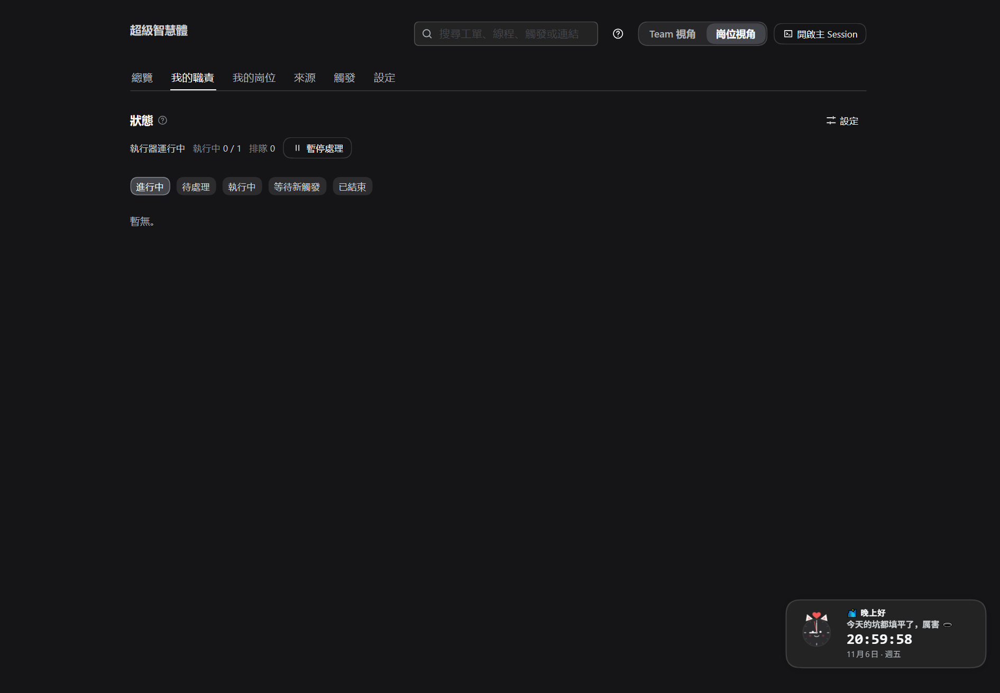

# ABC · 快速上手：把超级智能体带到"可以接单"的状态

> **给谁看**：第一次把超级智能体带进真实工作的 **PM（带队伍的人）** 和 **Worker（干具体活的人）**。
> **多久**：PM 约 **40–60 分钟**，Worker 约 **15–25 分钟**；两人第一次合练约 **30 分钟**。
> **前提**：账号和资源都已经齐备（见 §1 清单）——这份指南**不讲技术**，只讲"在哪个页面、点什么、填什么、怎么知道做成了"。
>
> 背景（为什么这样做）：[AIOS.md](AIOS.md)（组织世界观）· [SOP.md](SOP.md)（完整操作手册）· [STORY.md](STORY.md)（一个完整故事）。
> 本指南是它们的**精简快速版**：把"一个组织从零到能接单"压缩成两条路线。
>
> 截图说明：图片来自真实运行中的面板；点击图片可放大。截图脚本见 [scripts/capture-abc-shots.mjs](scripts/capture-abc-shots.mjs)。

---

## 1. 开始之前：请确认这些东西已经备齐

> 这一步是"假设已齐备"的检查表。任何一项缺失，先补齐再开始；**缺账号不等于不会用**，而是还没到这一步。

| 类别 | PM 需要 | Worker 需要 |
| --- | --- | --- |
| 工作空间（看板） | Kanban 工作区 + 一个项目；**管理员**账号、API key | Kanban 账号（被加入同一工作区，是项目成员） |
| 组织公约（宪章） | Gitea 上有一个**宪章仓库**（建议 `README.md`），和有写权限的账号 | 不需要（Worker 通过面板读宪章，不用 Gitea 账号） |
| 文件柜（资产） | MinIO 的桶和访问凭据（PM 配一次，全队共用） | 不需要 |
| 消息（通知） | ntfy 服务器 + 项目 topic（可选，但建议有） | 不需要（PM 配好即可；如需独立 sender 由 PM 登记） |
| 每台机器 | 一台装了 DSH、能打开面板的电脑 | 同上，**一个岗位一台**（也可先在 PM 电脑上演练） |

> 一句话记住分工：**PM 负责"把台子搭好"，Worker 负责"上台干活"**；两边用同一块看板协作，不靠互相打电话。

---

## 2. 世界观 60 秒（用业务语言）

- **看板 = 派工台**：所有工作都从看板上的卡开始，卡上写着"做什么、谁来做、要产出什么"。
- **宪章 = 团队公约**：这一期我们怎么做事、交付到什么标准、出了问题怎么处理。**没有公约不开工**，公约每周最多改一版。
- **岗位 = 机器人同事**：PM 岗位像"项目经理"，Worker 岗位像"执行同事"；每个岗位有自己的看板身份。
- **职责说明 = 任务说明书**：每类任务的目标、完成标准、交付物放哪、步骤和常见坑。卡片用"职责编号"声明自己属于哪一类。
- **四个家**：看板管**事**，Gitea 管**规则（宪章/职责说明）**，MinIO 管**文件/交付物**，ntfy 管**通知**。
- **PM 给谁派活**：默认派给 Worker 岗位，**不派给 PM 自己**；只有公约里明确写了"PM 可执行职责"才例外。

---

## 3. 打开面板（两条路线共用）

1. 打开 DSH → 进入任意工作区 → 看左侧图标列，找到 **「超级智能体」**（锤子图标）。
2. 点它，进入「超级智能体」面板。面板顶部有两个视角开关：**Team 视角**（PM 用）和 **岗位视角**（Worker 用）。
3. 第一次进 Team 视角时，如果账号没有管理看板的权限，面板会弹窗说明；点"仍然切换"也能看，但改流程会受限——**请用管理员账号做 PM 的配置**。


*图 A-1：Team 视角。左侧是总览/编队/来源/触发/评估/执行/清理/设置；右上角可切「岗位视角」。*

**产出**：能看到「编队」「来源」「设置」等入口即成功。**做不成时**：图标找不到，说明这个 DSH 没装超级智能体插件，先按 [INSTALL.md](INSTALL.md) 安装并重启。

---

## 4. 路线 A：PM——把组织搭到"可以接单"（约 40–60 分钟）

> PM 的目标：让团队有公约、有岗位、有任务说明书、能派工，并且 Worker 能接单。

### A1. 把"四个家"的门牌号填好

**前置条件**：§1 的账号资源在手边；你在 Team 视角。

**操作**

1. 面板左侧点 **「来源」**。
2. 从上到下四张卡片，依次确认/填写：
   - **Kanban 看板**：填服务器地址和 API key；「项目」从下拉里**选**（不要手抄项目 id）；「监听的列」填 `ready`（或团队实际用的列）；「认领列」「交付列」按团队习惯填（如 `in-progress` / `done`）。
   - **Gitea（宪章仓库）**：填服务器、邮箱/密码（或令牌）、**宪章仓库**（`owner/name`）、宪章文件（默认 `README.md`）。
   - **MinIO 对象存储**：填服务地址、桶、Access key / Secret key（凭据可留空时自动取本机存储记录）。
   - **ntfy 主题**：填服务器、项目 topic；「入库过滤 tag」建议填团队约定的 tag（如 `dsh`），这样只有带 tag 的消息才会变成卡。
3. 每张卡片填完点 **「测试连接」**，通过后再点保存（保存按钮在卡片下方/页面底部）。


*图 A-2：来源页。四张卡分别对应看板、宪章仓库、文件柜、通知；先测连接再保存。*

**产出**：四张卡片都显示"已连接/正常"，或面板显示来源状态为 ready。
**做不成时**：测试连接失败先检查服务器地址与凭据；"项目"下拉为空，说明 API key 没有该工作区权限。

### A2. 登记"项目"和"机器人同事"（岗位）

**前置条件**：A1 的看板已连通（否则项目下拉为空）。

**操作**

1. 左侧点 **「设置」** → 左栏选 **「项目与岗位」**。
2. 在「项目」里**选择**要开工的项目（会带出名称与 slug；主题集可留空，默认 `pub_<项目 id>`）。
3. 滚动到「岗位」，点 **「新增岗位」**，至少登记两个岗位：
   - **PM 岗位**：岗位 id（如 `pm-rsi`）、名称、角色选 **PM 岗位**；Kanban 账号填 PM 的**登录邮箱**（保存时自动映射成看板使用者 id，下方会显示"已映射到…"）；监听列 `ready`；WIP 建议 3。
   - **Worker 岗位**：岗位 id（如 `w1-rsi`）、名称、角色选 **Worker 岗位**；Kanban 账号填这位 Worker 的**登录邮箱**；监听列 `ready`；WIP 建议 2–3。
4. 点页面底部 **「储存档案」**。


*图 A-3：先选项目；名称/slug 自动填。*


*图 A-4：岗位卡。填"Kanban 账号（登录邮箱）"，保存后自动映射成使用者 id；监听列决定它领哪些列的卡。*

**产出**：岗位卡下方出现 **"已映射到 Kanban 使用者 id：…"**；保存成功提示"已保存"。
**做不成时**：提示邮箱不在工作区成员里——让该同事先加入 Kanban 工作区，或换一个成员邮箱；不知道对方的登录邮箱，可以让对方在 Kanban 个人资料里查看。

### A3. 发布第一版"团队公约"（宪章）

**前置条件**：A1 的 Gitea 宪章仓库已连通；A2 的项目已保存。

**操作**

1. 仍在 **「设置」→「项目与岗位」**，向下找到 **「宪章」**。
2. 在"宪章正文"里写第一版（不用长，二三十行即可，建议包含）：
   - **目标与客户价值**：我们这一期要为客户创造什么。
   - **当期流程**：看板列怎么走（如 `ready → in-progress → in-review → done`）。
   - **岗位与职责边界**：PM 管什么、Worker 管什么（可指向"职责说明"）。
   - **交付标准**：什么算完成、交付物放哪、要不要人验收。
   - **异常处置**：卡住、需要人拍板、失败时找谁。
3. 点 **「发布宪章」**。右上角的版本号从 v0 变成 v1，发布时间/发布者自动记录。
4. 提醒：**宪章每周最多发布一版**；要覆盖限制需在正文说明理由。


*图 A-5：宪章区。版本号、发布时间、发布者、正文、发布按钮都在这一屏。*

**产出**：宪章显示 **v1**，发布者与时间正确。
**做不成时**：按钮不可点，通常是正文为空；发布失败，检查 Gitea 仓库权限（或先确认宪章仓库填对）。

### A4. 发布"任务说明书"（职责说明）

**前置条件**：A3 宪章已发布（职责说明与宪章放在同一个 Gitea 仓库）。

**操作**

1. 同页向下找到 **「职责说明」**，点 **「编辑职责说明」**。
2. 为团队要做的每一类活写一段（每个职责必须写清四件事：**做什么、什么算完成、交付物放哪、谁承接**）。示例：

   ```text
   ### doc · 文档交付
   - 承接岗位：w1-rsi
   - 目标：按卡片要求产出一份可复用的文档
   - 完成：文档已上传并可回读，卡片回写了文件位置
   - 载体：MinIO 对象（deliverables/<项目>/<工单>/<文件名>）
   - 步骤：读宪章 → 读卡片 → 写文档 → 上传回读 → 报告
   ```

3. 点 **「发布职责说明」**（提交到宪章仓库同目录的 `duties.md`）。


*图 A-6：职责说明区。写清"承接岗位/目标/完成/载体/步骤"；这里发布的每一条，卡片都能用 `duty:<id>` 引用。*

**产出**：职责列表出现在页面上；编辑后保存成功。
**做不成时**：提示没有 Gitea 权限 → 检查 A1 的 Gitea 卡片；PM 自己不干执行活时，**承接岗位写 Worker 岗位**，不要写 PM 岗位（否则派工会被 PM 闸门拦下）。

### A5. 上线自检：可以接单了吗？

**前置条件**：A1–A4 都已完成。

**操作**：回到 **「编队」** 页，从上到下看三件事：

1. 项目卡片显示宪章的版本（不是 v0）。
2. 岗位卡片出现，并且显示"在飞职责"（0/上限）、身份已映射。
3. 来源页四张卡的状态正常（没有红色报错）。


*图 A-7：编队页是 PM 的"驾驶舱"：项目、岗位、宪章版本、在飞职责、异常队列。*

**产出**：**团队进入"可以接单"状态**——看板上一张指派给 Worker 岗位的卡，会被接走并生成工单。

### A6. 派第一张卡（第一次真实派工）

**前置条件**：A5 自检通过；有一件真实的小事可做（例如"写一份一页纸的方案"）。

**操作（在 Kanban 看板里，不在超级智能体面板里）**

1. 在项目看板点「新建任务」，标题写清楚要什么（业务语言，不写实现细节）。
2. 给卡片打三个标签（有就填，没有可先不填）：
   - **职责**：`duty:doc`（对应 A4 发布的职责 id）；
   - **产出类型**：`kind:doc`（文档/方案）或 `kind:code`（代码）；
   - **仓库**（仅代码类需要）：`repo:owner/name`。
3. **指派给 Worker 岗位的账号**（不是 PM 自己！）。
4. 把卡片**移动到监听列**（如 `ready`）。

**产出**：几十秒内，编队页会看到这条"在飞职责"；Worker 面板的"我的职责"出现这张卡。
**做不成时**：
- 一直没被接走 → 看卡片是否真的指派给了 Worker、是否进了监听列；
- 面板提示"职责未定义" → 回 A4 检查 `duty:<id>` 是否写对；
- 提示"PM 不执行工人职责" → 卡被派给了 PM，改派给 Worker。

### A7. PM 的日常节奏（每天 10 分钟 + 每周一次复盘）

- **每天早上**：看「编队」页的**异常队列**——等回复/阻塞/失败的工单，逐条处理（补上下文、给结论、拆卡或重试）。
- **随时**：看"在飞职责"，超过岗位上限就先暂停派新卡。
- **每周一次复盘**：看这一周交付了什么、卡在哪、哪条规则不好用；改进项**写成新卡**继续走看板，规则改动**发布新宪章**（每周最多一版）。

---

## 5. 路线 B：Worker——从"被登记"到"交第一单"（约 15–25 分钟）

> Worker 的目标：确认自己是谁（哪个岗位）、能收到派给自己的卡、知道怎么交付、交付后知道怎么回写。

### B1. 确认你已经"被登记"

**前置条件**：PM 已完成 A2（在项目里新增了你的 Worker 岗位，并填了你的登录邮箱）。

**操作**：问 PM 确认三件事：你的**岗位 id**（如 `w1-rsi`）、你的 **Kanban 登录邮箱**、你**监听哪一列**（如 `ready`）。
**产出**：PM 那边能看到"已映射到 Kanban 使用者 id：…"。

### B2. 打开面板并切到"岗位视角"

**操作**

1. 打开 DSH → 工作区 → 左侧点 **「超级智能体」**。
2. 在面板顶部点 **「岗位视角」**。
3. 如果这是第一次，面板会让你确认这个岗位属于你（按 PM 登记的岗位选择即可）。


*图 B-1：岗位视角。左侧变成"我的职责/我的岗位/来源/触发/设置"；右上角仍在、可切回 Team 视角。*

**产出**：左侧出现 **「我的岗位」** 和 **「我的职责」**。
**做不成时**：提示"未设置岗位"，说明 PM 还没在项目里登记你（回 A2）。

### B3. 核对自己的"工位"

**操作**：点 **「我的岗位」**，核对四项：岗位名称与 id、角色（Worker）、监听列、并发上限（WIP）。这里**不能改**由 PM 定的身份信息（岗位视角是只读的），发现问题找 PM 调整。


*图 B-2：我的岗位。确认自己是哪个岗位、监听哪一列、WIP 多少。*

**产出**：信息与 PM 登记一致。
**做不成时**：找不到自己的岗位 → PM 登记时选错项目或岗位角色，回 A2 修正。

### B4. 确认"信息入口"是通的

**操作**：点 **「来源」**，看四张卡的状态：看板、宪章仓库、文件柜、通知。都是正常即可；岗位视角里它们是**只读**的（由 PM 统一配置），你只需要确认"没有红色报错"。

**产出**：来源正常，表示你能收到看板派工、读得到宪章、传得上去文件。

### B5. 接第一张卡

**前置条件**：PM 在 A6 派了卡，并且指派给了你、放进了监听列。

**操作**

1. 等 15–60 秒（看板轮询有间隔），左侧 **「我的职责」** 出现新工单。
2. 点开工单，先做 **开工第一步**：读当期宪章（工单里会带"职责简报"，包含目标/完成标准/交付位置）。
3. 按"职责说明"的步骤干活；有歧义**不要猜**——在卡片评论里提问，把状态报告为"等待/阻塞"，它会出现在 PM 的异常队列。



*图 B-3：我的职责：收到派工后在这里看工单、开工。*

**产出**：工单从"待处理"变成"执行中"。
**做不成时**：一直没有工单 → 让 PM 确认卡片指派与监听列；提示"没有宪章" → PM 还没发布宪章；提示"职责未定义/岗位不承接" → PM 的职责说明或承接岗位要改。

### B6. 交付：放在唯一的地方，回写看板

**操作**

1. **文档/方案**：上传到文件柜（MinIO），文件位置按"职责说明"里的格式（`deliverables/<项目>/<工单>/<文件名>`）；上传后**回读一次**确认能打开。
2. **代码**：提交到卡片指定的仓库，开一个 PR，把 PR 链接作为交付物。
3. 在面板/工单里报告 **"完成"**，写清：做了什么、检查了什么、交付物在哪里（文件位置或 PR 链接）。
4. **不要自己去看板搬卡**：看板由系统回写；你报告后，卡片会自动更新状态与日志。

**产出**：卡片状态变成"完成/交付列"，卡片评论里出现你的工作日志和交付物位置；PM 在编队页能看到这张卡结束。
**做不成时**：卡片没动 → 检查是否真的报告了"完成"；文件打不开 → 检查文件位置是否写错、重新上传。

### B7. Worker 的日常小抄

- **每天开工**：看「我的职责」有没有新工单；先读宪章与职责简报，再动手。
- **卡住时**：卡片评论提问并报告阻塞，让它进 PM 的异常队列，不要自己硬猜。
- **收工前**：每张卡都有工作日志、状态已更新、交付物可打开。
- **每周复盘**：把"哪一步最费劲、哪个说明不清楚"告诉 PM，让职责说明和宪章变得更好用。

---

## 6. 两人第一次合练（约 30 分钟）

> 走一遍"从派工到交付"的最小闭环，确认这台机器/这个团队真的能跑。

| 顺序 | 谁 | 做什么 | 怎么算过关 |
| --- | --- | --- | --- |
| 1 | PM | 在 Kanban 建一张小事卡：`duty:doc` + `kind:doc`，指派 Worker，移入 `ready` | 卡片在看板可见、指派正确 |
| 2 | Worker | 60 秒内在「我的职责」看到工单，读宪章与职责简报 | 工单状态为"执行中" |
| 3 | Worker | 产出文档 → 上传文件柜 → 回读确认 → 报告完成 | 卡片评论出现交付物位置与工作日志 |
| 4 | PM | 在「编队」页确认这张卡结束、无异常 | 卡片到"完成"列，异常队列无这条 |
| 5 | 两人 | 各说一条"哪里不顺手" | 至少形成 1 个改进项（写成新卡或改职责说明） |

**合练通过的标准**：PM 的编队页看不到红色异常；Worker 的我的职责清空（或只剩下一张正在做的卡）。

---

## 7. 常见卡点（业务语言版）

| 现象 | 多半是 | 怎么办 |
| --- | --- | --- |
| 面板一直是"加载中" | 插件没装好/没重启 | 按 [INSTALL.md](INSTALL.md) 安装，重启 DSH |
| 项目下拉是空的 | 看板账号没权限，或地址填错 | 换管理员 API key，检查服务器地址 |
| 保存岗位时提示"邮箱不在工作区" | 这位同事还没加入看板工作区，或邮箱拼错 | 先邀请加入工作区；用他在看板的登录邮箱 |
| 卡片一直没人接 | 没指派给 Worker、没进监听列，或 Worker 没上线 | 检查指派与列；让 Worker 打开面板确认来源正常 |
| 提示"没有宪章" | 宪章还是 v0 | 回 A3 发布宪章 |
| 提示"职责未定义" | 卡片上的 `duty:<id>` 与职责说明对不上 | 回 A4 检查/补写该职责 |
| 提示"PM 不执行工人职责" | 卡派给了 PM 岗位 | 改派给 Worker 岗位；或在宪章写明"PM 可执行职责" |
| 提示"岗位不承接这个职责" | 职责说明里的"承接岗位"没写你 | PM 在 A4 把承接岗位改成你的岗位 id |
| 交付物找不到 | 上传位置写错，或没回读 | 按职责说明的位置重新上传并回读 |
| 卡片停在中间不动 | 工单在等回复/阻塞/失败 | PM 看异常队列处理；Worker 看工单评论 |

---

## 8. 名词小抄（业务视角）

| 你会听到 | 其实就是 |
| --- | --- |
| 宪章 / Charter | 团队公约：这一期怎么做事、交付到什么标准 |
| 职责说明 / duties | 任务说明书：每类活怎么做、什么算完成、交付物放哪、谁承接 |
| 岗位 / Post | 一位"机器人同事"（PM 或 Worker），有自己看板身份 |
| 岗位职责 / Duty | 某位同事正在做的一张任务 |
| 看板 / Kanban | 派工台：任务从卡开始，状态在列之间流动 |
| 来源 / Source | 信息入口：看板、宪章仓库、文件柜、通知 |
| 交付物 / Deliverable | 这次活的成果：文档/方案放文件柜，代码放 PR |
| 异常队列 | 需要人拍板或处理的问题清单（PM 每天看） |
| WIP | 一个岗位同时最多做几张卡 |
| Team 视角 / 岗位视角 | PM 的管理台 / Worker 自己的工作台 |

---

## 9. 接下来

- 想先看一个完整故事（一条消息如何变成交付）：[STORY.md](STORY.md)
- 想看每天的完整操作手册：[SOP.md](SOP.md)
- 想知道为什么这样设计：[AIOS.md](AIOS.md) · [RD.md](RD.md)
- 想验证"这个团队真的跑起来了"：每个新组织先跑一遍 §6 的合练，再逐步加卡、加岗位。

> **把超级智能体带进现实，不是装一个软件，而是和它一起立一部公约、排一次工、交一次货。**
> 从"能接单"到"跑得顺"，中间只差每周一次复盘。
