# ABC · 15 分钟把运行环境准备好

> **这份指南只做一件事**：按面板「设置」把运行环境配好，并让你**一眼看出它是 OK 的**。
> **不跑任务、不讲怎么干活**——准备好之后怎么派工、接单、交付，见 [SOP.md](SOP.md)。
> **给谁看**：PM（动手配置，15–20 分钟）；Worker 只看 §5（3 分钟，只读确认）。
> **前提**：账号与资源已备齐（§0.1）。截图来自真实面板，点击可放大。
>
> 演示稿（16:9，与 SOP/AIOS 同一套样式）：[ABC.html](ABC.html) · [ABC.pdf](ABC.pdf)。

---

## 0. 30 秒看懂全貌

### 0.1 前置清单（已齐备才开工）

| 需要 | 说明 |
| --- | --- |
| Kanban 工作区 + 项目 | PM：管理员账号 + API key；Worker：是项目成员 |
| Gitea 宪章仓库 | PM：有写权限，仓库里放 `README.md` |
| MinIO 桶 + 凭据 | 交付物/文件的家 |
| ntfy 服务器 + topic | 通知与消息入库（可选但建议） |
| 装好 DSH 的电脑 | 每台机器能打开「超级智能体」面板 |

### 0.2 你要做的事，只有这些

**4 个 tab、9 个动作、约 15 个必填字段；其余全部保持默认。**

| # | 在哪 | 动作 | 大约 |
| --- | --- | --- | --- |
| A1–A4 | 设置 → **来源** | 4 张卡各填 2–4 个字段，测试连接，保存 | 6 分钟 |
| A5 | 设置 → **项目与岗位** | 选项目；加 PM、Worker 两个岗位；保存档案 | 4 分钟 |
| A6 | 设置 → **项目与岗位** | 宪章正文（有模板）→ 发布 | 2 分钟 |
| A7 | 设置 → **项目与岗位** | 职责说明（有模板）→ 发布 | 2 分钟 |
| A8 | 设置 → **评估** | 接单模式 = 自动接单；模型可用；保存 | 1 分钟 |
| A9 | 设置 → **执行** | 执行器模型可用；其余默认；保存 | 1 分钟 |
| — | 设置 → **提示词 / 部署** | **不用动**，只在自检里确认能打开 | — |

打开方式：DSH → 左侧 **「超级智能体」** → 顶部 **Team 视角** → 左侧 **「设置」**。设置页左侧就是这六个 tab：

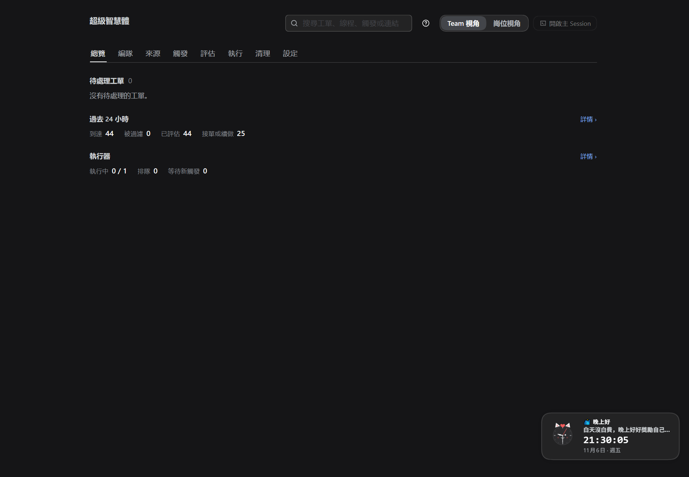

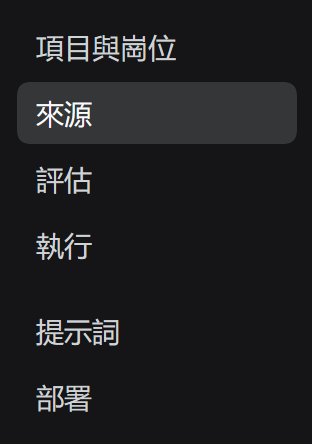

*图 0：设置页六个 tab。你只会动前四个，后两个保持默认。*

> 界面语言可能是简体或繁体，按钮文字会相应变化（如"设置/設定"）；按**同名按钮**找即可，下文统一写简体。

---

## 1. 来源 tab：接上四个"家"

**一句话**：看板管任务、宪章仓库管规则、MinIO 管文件、ntfy 管通知。四张卡，每张**填完 → 测试连接 → 保存**。

| 卡片 | ★必填 | 其余 |
| --- | --- | --- |
| Gitea（宪章仓库） | 服务器、账号/密码、宪章仓库 `owner/name` | 宪章文件默认 `README.md` |
| Kanban 看板 | 服务器、API key、**项目（下拉选）**、监听的列 `ready` | 认领列/交付列按团队习惯，可后改 |
| ntfy 主题 | 服务器、topic | 入库 tag 建议填 `dsh`（留空=全部） |
| MinIO 对象存储 | 服务地址、桶 | Access/Secret key 可留空，用本机存储记录 |

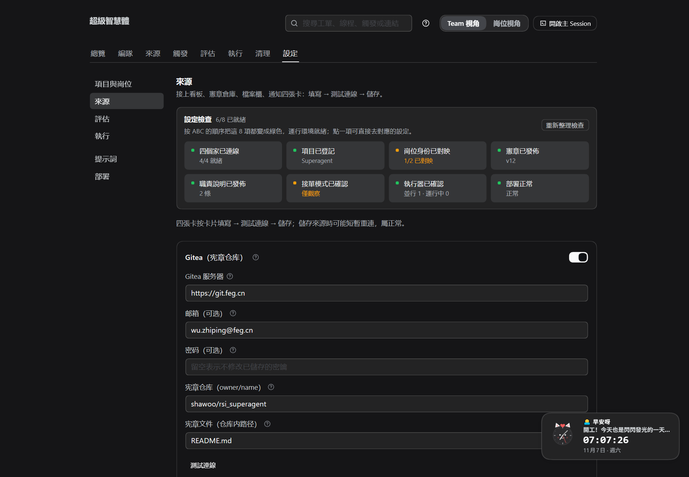

*图 1：四张卡 = 看板 / 宪章仓库 / 文件柜 / 通知。*

**看到什么算 OK**：四张卡没有红色报错；「编队」页来源状态正常。
**小提示**：保存来源后面板可能提示"正在重启/重连"几秒钟，这是正常的，等它恢复即可。

---

## 2. 项目与岗位 tab：告诉系统"谁在这干活"

> 这一个 tab 里完成 A5–A7：**选项目 → 加两个岗位 → 发布宪章 → 发布职责说明**。

### A5. 选项目 + 加两个岗位

1. 「项目」下拉里**选**项目（不要手抄 id），名称与 slug 会自动带出。
2. 「岗位」→ **新增岗位**，加两张卡，只填 ★ 三项：

| ★ 字段 | PM 岗位 | Worker 岗位 |
| --- | --- | --- |
| 岗位 id | `pm-<项目>` | `w1-<项目>` |
| 角色 | **PM 岗位** | **Worker 岗位** |
| Kanban 账号（登录邮箱） | PM 的登录邮箱 | Worker 的登录邮箱 |

> 监听列填 `ready`（与来源里一致）；WIP 默认即可。其余（Gitea 账号、ntfy sender、实例）可留空。
3. 页面底部 **保存档案**。

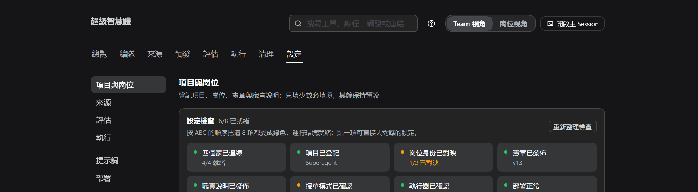

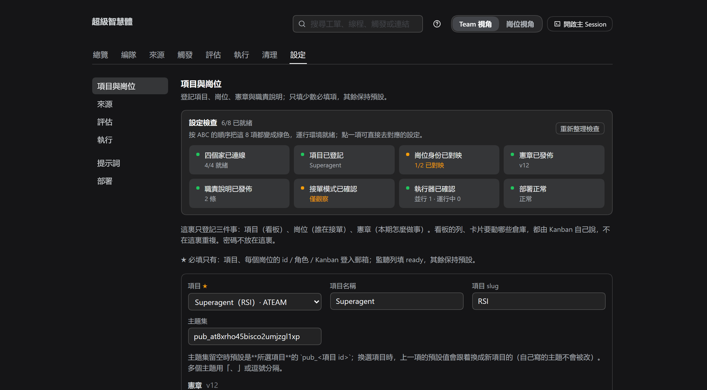

*图 2：项目与岗位。邮箱保存后自动映射成看板使用者 id。*

**看到什么算 OK**：每张岗位卡下方出现 **"已映射到 Kanban 使用者 id：…"**。

### A6. 发布宪章（复制这 5 行就能用）

在「宪章正文」里填下面模板（可按团队改），然后点 **发布宪章**：

```text
目标：<这一期为客户创造什么>
流程：ready → in-progress → in-review → done
岗位：PM 负责派工、审进度、处理异常；Worker 负责执行与交付
交付：文档/方案放 MinIO；代码开 PR；卡片回写结果
异常：卡住 → 评论提问并转 blocked，进 PM 的异常队列
```

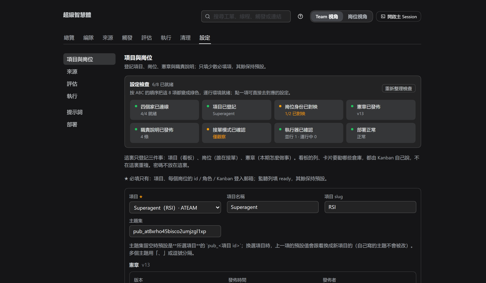

*图 3：宪章区。发布后版本从 v0 变 v1；每周最多发布一版。*

**看到什么算 OK**：版本号 **≥ v1**，有发布时间与发布者。

### A7. 发布职责说明（复制这段就能用）

找到「职责说明」→ 编辑 → 用模板改一个职责（承接岗位写 **Worker 岗位 id**）：

```text
### doc · 文档交付
- 承接岗位：w1-<项目>
- 目标：按卡片要求产出一份文档
- 完成：文件已上传并可回读，卡片回写文件位置
- 载体：MinIO 对象（deliverables/<项目>/<工单>/<文件>）
- 步骤：读宪章 → 读卡片 → 写文档 → 上传回读 → 报告
```

然后点 **发布职责说明**。

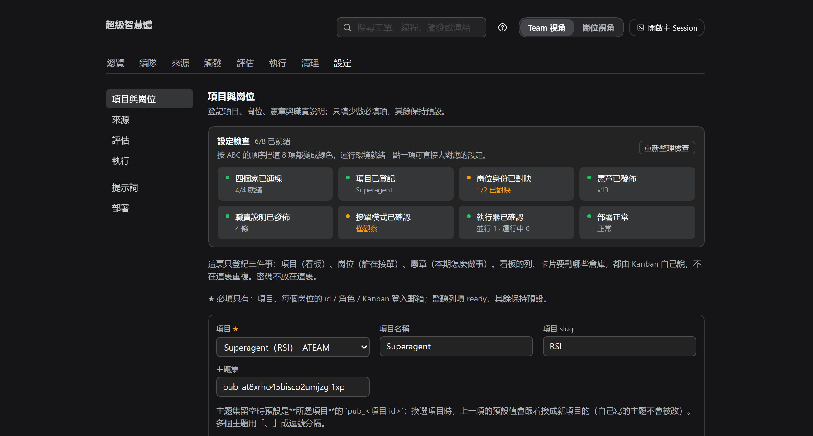

*图 4：职责说明区。承接岗位写 Worker，不要写 PM（PM 默认不执行工人职责）。*

**看到什么算 OK**：职责列表出现，条数与你写的一致。

---

## 3. 评估 tab：让系统自己"接单"

**只动两个地方**：

1. **接单模式** → 选 **自动接单**（另两个选项：关闭 / 仅观察）。
2. **研判模型** → 默认可用就不动；显示"默认模型暂不可用"就选一个可用的服务商/模型。

然后保存。

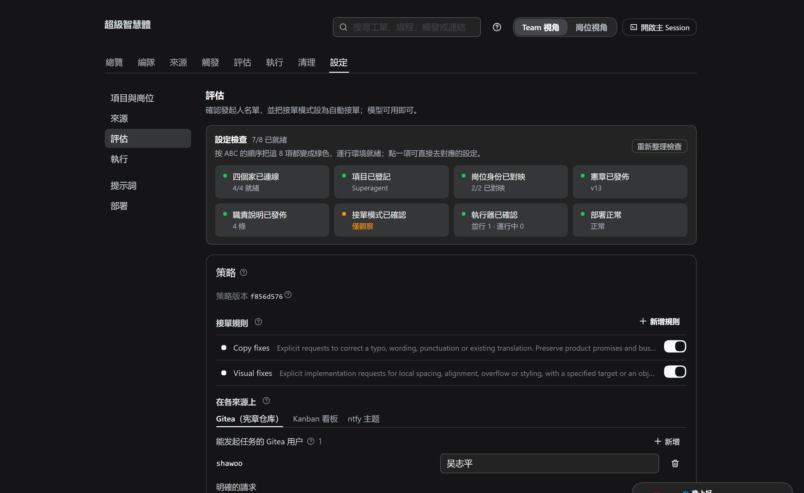

*图 5：评估 tab：发起人名单、接单模式、单次评估时限、研判模型。*

**看到什么算 OK**：接单模式显示 **自动接单**；模型可用；保存成功。

---

## 4. 执行 tab：确认"谁来干、并行多少"

**只确认两件事**：

1. **执行器模型**：可用即可（不可用就选一个）。
2. **并行工单数**：建议 1–2；执行目录可留空用默认。

然后保存。

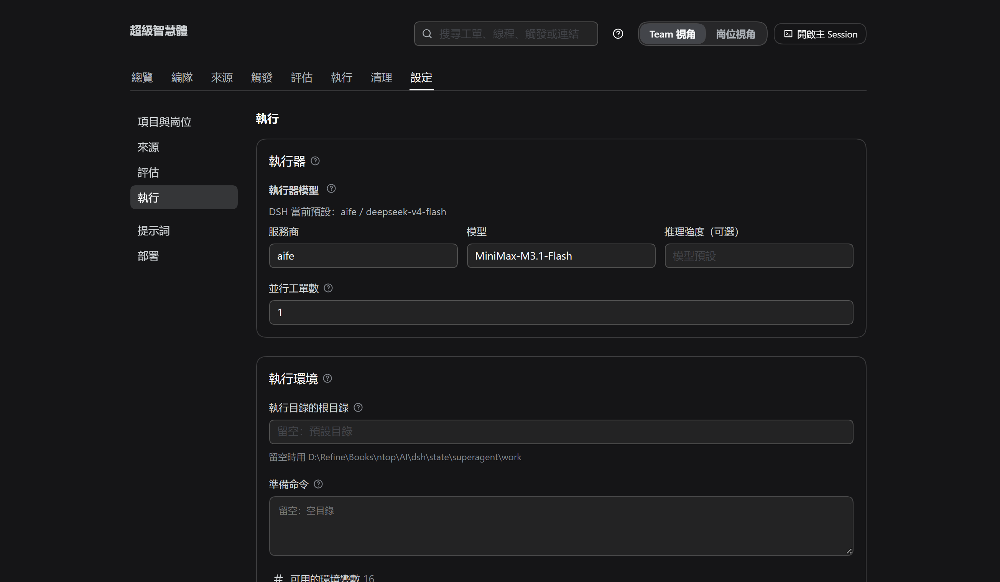

*图 6：执行 tab：执行器模型、并行工单数、执行环境。*

**看到什么算 OK**：保存成功；「编队」页/岗位视角显示执行器运行中、无红色报错。

---

## 5. 就绪自检：8 项打勾，环境就绪

| # | 检查项 | 在哪看 | OK 的样子 |
| --- | --- | --- | --- |
| 1 | 看板已连接 | 设置 → 来源 → Kanban | 测试连接通过，项目可选 |
| 2 | 宪章仓库已连接 | 设置 → 来源 → Gitea | 测试连接通过 |
| 3 | 文件柜、通知已连接 | 设置 → 来源 → MinIO / ntfy | 无红色报错 |
| 4 | 项目已登记 | 设置 → 项目与岗位 | 项目名称/slug 已填 |
| 5 | 两个岗位已映射 | 设置 → 项目与岗位 → 岗位 | 两张卡都有"已映射到 …" |
| 6 | 宪章已发布 | 设置 → 项目与岗位 → 宪章 | 版本 ≥ v1 |
| 7 | 职责说明已发布 | 设置 → 项目与岗位 → 职责说明 | 列表有内容，承接岗位正确 |
| 8 | 接单与执行就绪 | 设置 → 评估 / 执行 | 自动接单 + 模型可用 |

**8 项全勾 = 运行环境已就绪。** 之后怎么派工、接单、交付，见 [SOP.md](SOP.md) / [STORY.md](STORY.md)。

---

## 6. 设置结果怎么看（掌控感）

记住这几行，你就能随时判断"现在是什么状态、要不要动手"：

| 你看到的 | 含义 | 你需要做什么 |
| --- | --- | --- |
| 来源卡 **正常 / ready** | 这条路通了 | 不用管 |
| 来源 **暂停 / paused** | 这项被关掉了（或还没配） | 想用就打开并保存 |
| 来源 **错误 / error** | 地址、凭据或权限不对 | 按提示改，再测一次 |
| 岗位卡 **已映射到 Kanban 使用者 id：…** | 系统知道这张卡派给谁 | 不用管 |
| 宪章 **v1 / v2…** | 团队公约已生效 | 每周复盘后最多改一版 |
| 职责说明 **1 条 / N 条** | 系统认得这几类活 | 新增活法时再来加 |
| 接单模式 **自动接单** | 系统会自己接单开工 | 不用管；想先观察就改"仅观察" |
| 接单模式 **仅观察** | 只看不接（演练用） | 正式开工前改回"自动接单" |
| 执行器 **0 / 1，排队 0** | 目前没有在跑的活 | 不用管；有活时会动 |
| 岗位视角 **我的岗位** | Worker 只读确认 | 不对就找 PM 改 |

---

## 7. Worker：3 分钟只读确认

**不需要改任何设置**，只确认三处（不对就找 PM 回上面的 tab 修）：

1. 面板顶部切 **岗位视角** → 左侧 **「我的岗位」**：岗位 id、角色 Worker、监听列、WIP 与 PM 登记一致。
2. 左侧 **「来源」**：四张卡是只读的，没有红色报错。
3. 面板没有"未设置岗位"之类提示。

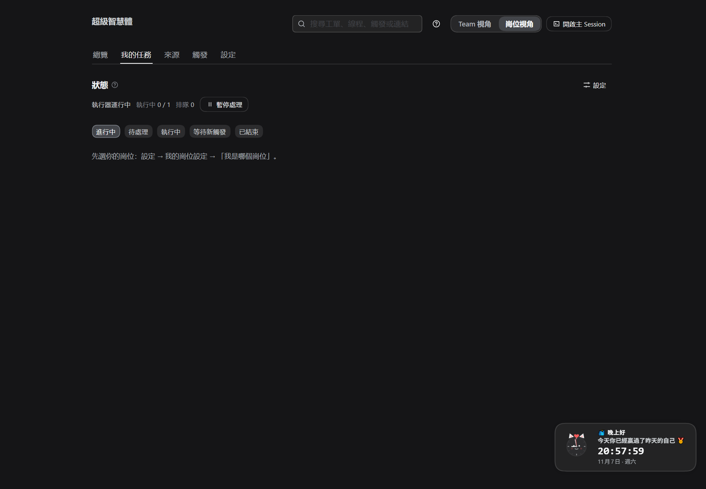

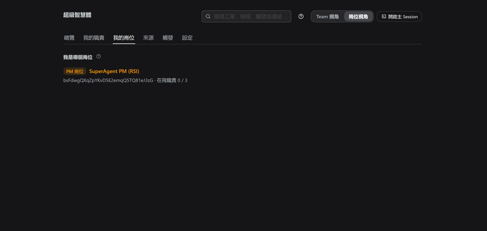

*图 7 / 8：岗位视角与我的岗位（只读）。*

---

## 8. 设置阶段常见问题（按 tab 定位）

| 现象 | 多半在哪个 tab | 怎么办 |
| --- | --- | --- |
| 来源连不上 | 来源 | 检查地址/凭据；密钥可留空用本机存储记录 |
| 项目下拉是空的 | 来源（看板） | API key 没有该工作区权限，或地址错 |
| 提示"邮箱不在工作区成员里" | 项目与岗位（岗位） | 让同事先加入 Kanban 工作区，或用其登录邮箱 |
| 发布宪章失败 | 项目与岗位（宪章） | Gitea 仓库没有写权限，或仓库/文件名填错 |
| 职责列表为空 | 项目与岗位（职责说明） | 还没发布，或正文为空 |
| 模型显示"默认不可用" | 评估 / 执行 | 选一个可用的服务商与模型 |
| 保存时提示冲突 | 项目与岗位 | 别人同时改过：重新载入后再保存 |

---

## 9. 一句话

**4 个 tab、9 个动作、8 项自检——运行环境就绪。** 剩下的是工作方式，交给 [SOP.md](SOP.md)。
配套世界观：[AIOS.md](AIOS.md)；完整故事：[STORY.md](STORY.md)。
