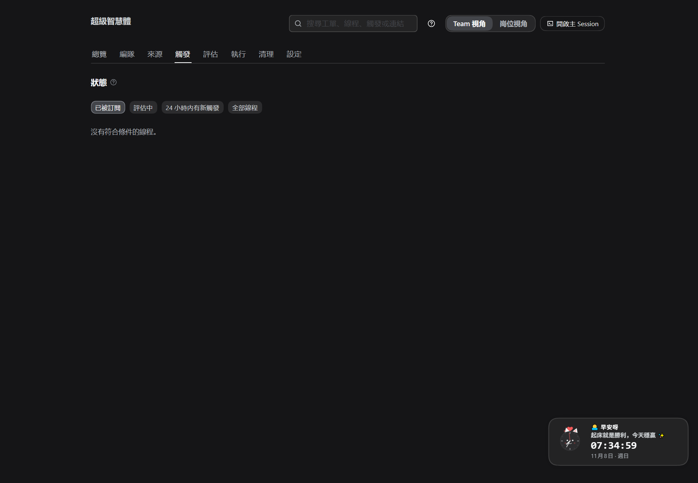
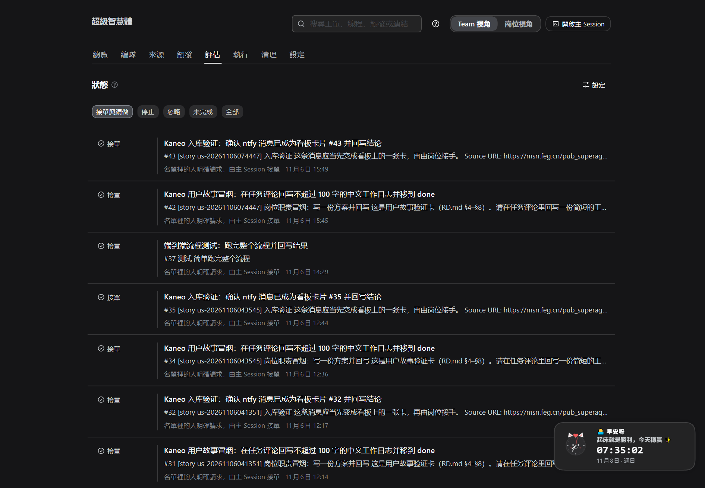
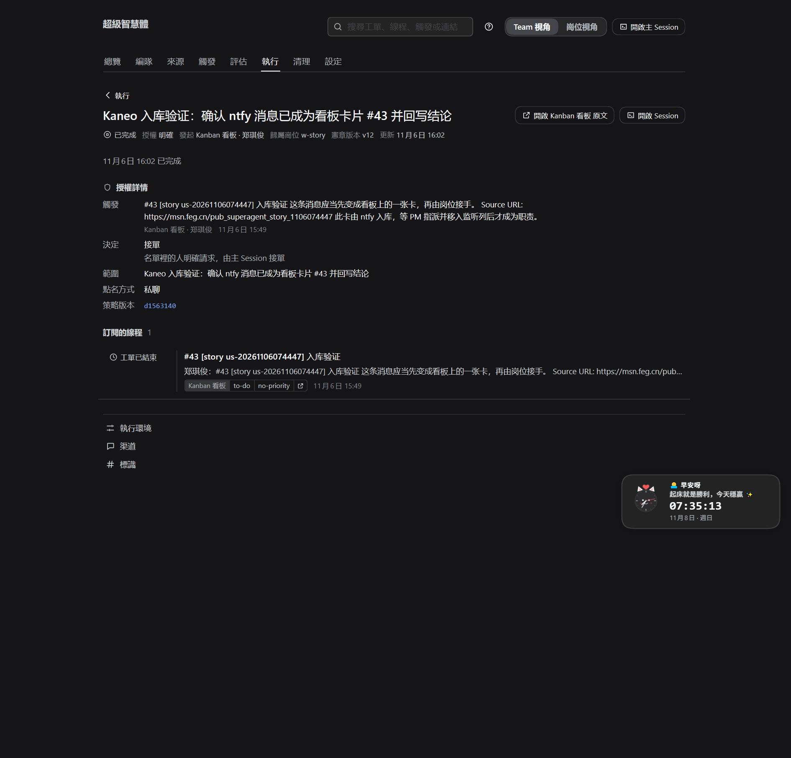
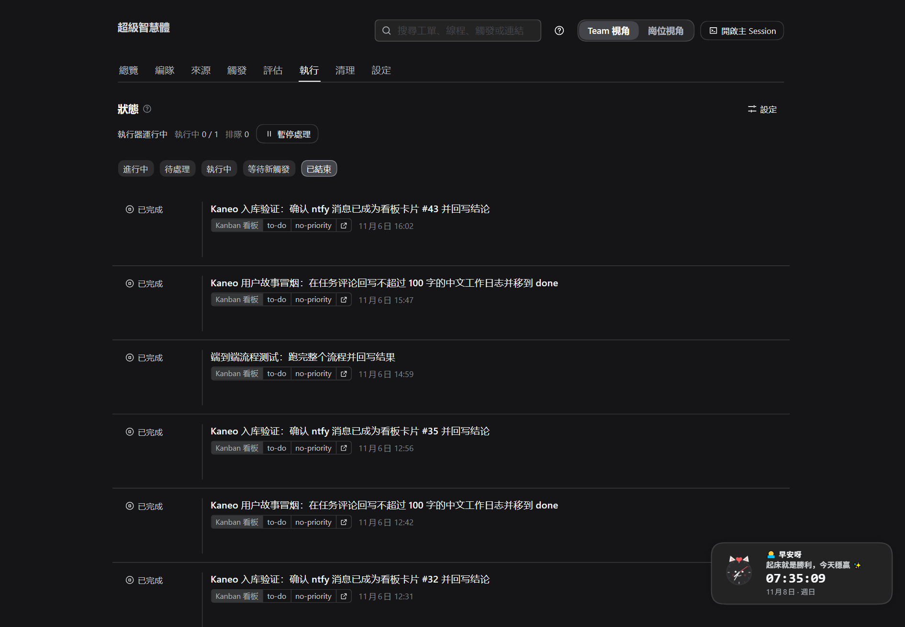

# DEF · 一个需求是怎么变成工单的（触发 → 评估 → 工单）

> **这份指南只做一件事**：跟着一张需求（一张看板卡 / 一条聊天消息）走完它的一生，看清它**什么时候被系统看见、谁决定要不要接、接了就变成什么**。
> **不配环境、不讲怎么交付**——环境准备见 [ABC.md](ABC.md)，干活与交付见 [SOP.md](SOP.md)。
> **给谁看**：PM（先走一遍，5–10 分钟）；Worker 只看 §6（2 分钟，知道自己的活是怎么来的）。
> **前提**：ABC 已做完，设置检查 8 项全绿。截图来自真实面板，点击可放大。

---

## 0. 30 秒看懂全貌

**一句话**：需求先变成**触发**（系统看见了它），再经过**判断**（要不要接），通过**闸门**后变成**工单**（一件可执行、有授权、有归属岗位的工作），最后才派给岗位去干。

```text
        ┌──────────────┐      ┌──────────────┐      ┌──────────────┐      ┌──────────────┐
需求 ──▶ │  触发 Trigger │ ──▶ │  判断 评估/路由 │ ──▶ │  闸门 宪章/职责 │ ──▶ │  工单 Ticket  │ ──▶ 岗位执行
        │ 系统"看见"了它 │      │  接 or 不接     │      │  岗位/PM 限制   │      │  有授权、有归属 │
        └──────────────┘      └──────────────┘      └──────────────┘      └──────────────┘
```

先把几个词对齐（面板里用的就是这些词）：

| 词 | 在这里的意思 | 一句话 |
| --- | --- | --- |
| **触发（Trigger）** | 系统"看见"的一条需求 | 看板卡进入监听列，或聊天里来了一条消息 |
| **线程（Thread）** | 需求的上下文 | 一张卡 = 一个线程；一段对话 = 一个线程 |
| **评估（Eval）** | 判断这条需求该不该接 | 只有"推断的候选"才需要模型研判 |
| **决定（Decision）** | 评估的结论 | 接单 / 忽略 / 未完成，每条都有理由 |
| **工单（Ticket）** | 变成可执行的工作 | 有标题、范围、授权依据和归属岗位 |
| **授权（Mandate）** | 凭什么干这件活 | 谁发起的、以什么方式（明确/推断）、按哪版策略 |
| **职责（Duty）** | 这类活怎么干 | 卡片用 `duty:<id>` 声明，规格在宪章仓库 `duties/` |
| **岗位（Post）** | 谁来干 | 本机 Team 里登记的岗位；工单有"归属岗位" |

---

## 1. 先确认：这一步依赖哪些设置

这些都在 ABC 里配好了，这里只说明它们**在这条链路里管什么**：

| 设置 | 在"需求 → 工单"里管什么 | 在哪 |
| --- | --- | --- |
| **来源 → 看板** | 监听哪些列（`to-do`）、发起人名单、接收范围 | 设置 → 来源 |
| **来源 → 看板（标签）** | 只收带指定标签的卡（默认不限） | 设置 → 来源 |
| **评估 → 规则** | 判断"这条消息像不像一件该干的活"的规则（copy / visual…） | 设置 → 评估 |
| **评估 → 接单模式** | 只影响**推断的候选**（聊天里没点名的消息）；看板卡不受影响 | 设置 → 评估 |
| **评估 → 时限 / 模型** | 一次研判最多 120 秒、用哪个模型 | 设置 → 评估 |
| **宪章 / 职责 / 岗位** | 三道闸门的依据（有没有规矩、这活怎么干、谁承接、PM 能不能干） | 设置 → 项目与岗位 |
| **执行 → 并行数 / 模型** | 工单建好后，同时能跑几个、谁来跑 | 设置 → 执行 |

> **最容易误会的一条**：**看板卡是"显式请求"**——人把卡放进监听列、指派了岗位，本身就是明确的工作请求。它走"**接单路由**"，**不看接单模式**，也不需要模型研判；接单模式（关闭 / 仅观察 / 自动接单）只决定**聊天里推断出来的候选**要不要接。
> 所以想"只观察、不真干"，光把接单模式改成"仅观察"是**拦不住看板卡**的；演练请看 §7。
>
> **本机现状**：来源只有 **看板 / Gitea / ntfy / MinIO**，且 ntfy 消息会**先入库成看板卡**（来源里的「其它来源先入库成卡」默认开）——所以这台机器上的需求都是看板卡，走的是"**路由**"；评估页记录的是路由决定。**模型研判（规则、接单模式、研判模型）要等接上聊天来源（如飞书）后才会出现**；想现在就演练，见 §7 方式 C。

---

## 2. D1 需求上板：先有一张像样的卡

演示用一张卡（内容可以换成你团队的真需求）：

| 卡上的东西 | 示例 | 为什么重要 |
| --- | --- | --- |
| 标题 | `登录页按钮颜色改成品牌色` | 会变成工单标题 |
| 描述 | 现状截图 + 期望的样子 + 验收口径 | 评估/派工时的依据 |
| 负责人（assignee） | 前端岗位的 Kanban 账号 | 决定**发起人**（没有负责人时用创建者） |
| 标签 | `duty:ui` | 声明这是哪类职责，闸门要用 |
| 所在列 | `to-do`（= 来源里配置的监听列） | 不在这列，系统不会看见 |

**看什么算 OK**：卡有负责人、有 `duty:` 标签、落在监听列。

> 进阶：一张卡也可以只有标题和描述（不写 `duty:`），照常会变成工单；但岗位的"职责简报"就没有了，只能在卡片线程里读上下文。**推荐每张卡都带 `duty:`**。

---

## 3. D2 触发：系统"看见"了它

**发生什么**：来源每 60 秒轮询一次看板；卡进入监听列、且发起人在该来源的名单里 → 生成一条**触发**。一张卡就是一个**线程**，卡上的每条新消息也会落在这个线程里。

**在哪看**：顶部 **「触发」** 页。默认看「已被订阅」的线程；可切「评估中」「24 小时内有新触发」「全部线程」。



*图 1：触发页。每行是一个线程（一张卡或一段对话），按线程归组；点开能看这条线程的每条触发与去向。*

**看什么算 OK**：卡放进监听列后 **1 分钟内**，触发页出现这个线程；线程状态是「已订阅」或「评估中」。
**看不到**：先看「来源」页的 24 小时统计——触发可能在**来源**就被过滤了（发起人不在名单、卡不在监听列、标签不匹配），来源页会写过滤原因。

---

## 4. D3 判断：接，还是不接

到这一步分两条路，**走哪条取决于需求是怎么来的**：

| 需求从哪来 | 系统的处理 | 会产生"评估"吗 |
| --- | --- | --- |
| **看板卡**（人放上板、指派了岗位；**含 ntfy 入库成的卡**） | **显式请求** → 主 Session 直接**接单路由** | 不研判，但会记一条决定：接单（理由：名单里的人明确请求） |
| **聊天消息**（名单内的人点名智能体） | **显式请求** → 同上，直接路由 | 不研判 |
| **聊天消息**（没点名，但发送人在名单里、且这个接收范围收全部消息） | **推断的候选** → 进**评估** | 会研判：接单 / 忽略 / 未完成 |
| **聊天消息**（发送人不在名单里） | 在策略层就被过滤 | 不评估；来源页显示"被过滤"及原因 |

### 4.1 推断的候选：评估到底在判什么

评估（主 Session 用评估模型）只回答四个问题，并对照**规则**：

| 判什么 | 好例子 | 差例子（会被忽略） |
| --- | --- | --- |
| 是不是在要"实现/修" | "把登录按钮改成品牌色" | "这个按钮好看吗？" |
| 目标是否明确 | 有截图、有既有规范、有明确期望 | "看着不太协调" |
| 要不要产品/设计决定 | 不用，照既有规范做 | 要重新设计整个交互 |
| 有没有证据 | 原话能引 | 只有猜测 |

结论只有三种，**每条都写理由**：

| 决定 | 含义 | 典型理由 |
| --- | --- | --- |
| **接单** | 变成工单 | "名单里的人明确请求，由主 Session 接单"（显式）/ 规则命中 + 证据充分（推断） |
| **忽略** | 不接 | 没有规则匹配 / 目标未定 / 只看不接（观察模式）/ 没有宪章 / 职责或岗位问题 |
| **未完成** | 这次没判完 | 评估超时、评估期间策略被改动 |

**接单模式三档**（只作用于推断的候选）：

| 模式 | 推断的候选会怎样 | 什么时候用 |
| --- | --- | --- |
| **关闭** | 不评估、直接忽略 | 只接受看板卡/点名请求 |
| **仅观察** | 评估后记录"忽略（可接单，仅观察）"，**不建工单** | 演练、先观察系统的判断准不准 |
| **自动接单** | 评估通过就建工单 | 正式运行 |

**在哪看**：顶部 **「评估」** 页，按「接单与续做 / 停止 / 忽略 / 未完成 / 全部」筛选。



*图 2：评估页。每行一条决定：结果、一句话理由、命中的规则、时间；点开回到线程或工单。*

**看什么算 OK**：评估页出现一行；结果和理由**一句话就能读懂**；不需要你去看日志。

---

## 5. D4 闸门：过不了就不建单

决定"接单"不等于马上开工。系统还会过四道闸门，**任何一道不过，就变成"忽略"并写明理由，不建工单**：

| 闸门（按检查顺序） | 不通过时的理由（决定里显示） | 怎么修 |
| --- | --- | --- |
| 项目已发布**宪章** | "这个项目还没有发布宪章，不能开工" | 设置 → 项目与岗位 → 发布宪章 |
| **PM 不执行工人职责** | "PM 岗位默认不执行工人职责…" | 把卡改派给 Worker 岗位；确实要 PM 干，在宪章写 `PM 可执行职责：<id>` |
| 卡片声明的**职责**已定义 | "卡片声明的职责在职责说明里没有定义" | 在职责说明里加这个 `duty:<id>` |
| 这个职责由**该岗位承接** | "这个职责由别的岗位承接" | 岗位卡「接哪些职责」下拉选中它，或改职责的承接岗位 |

> 这四道闸门就是"没有宪章不可开工 / 职责必须先定义 / 岗位必须承接 / PM 不给自己派活"的落地方式。**闸门不过，卡片不会建单，也不会被移列**。

---

## 6. D5 工单：它变成了什么

通过闸门后，需求才变成一张**工单**。工单和卡片/消息的区别是：它**有授权、有范围、有归属岗位**。



*图 3：工单页。上方是状态与「授权详情」（授权强度、发起人、决定、规则、范围、政策版本），下面是未送达的输入、订阅的线程与派工历史。*

| 工单上有 | 含义 |
| --- | --- |
| 标题 / 范围 | 从需求里提炼的一件可执行的事 |
| 授权（Mandate） | 强度（明确/推断）、发起人、决定、命中的规则、政策版本 |
| 归属岗位 | 这张工单属于哪个岗位（岗位 WIP 就按它算） |
| 职责简报 | 卡片带 `duty:` 时，岗位开工先读的这份规格摘要 |
| 状态 | 排队中 → 执行中 →（等待人：待回答/待验收/受阻/失败）→ 已结束（完成/合并/关闭/人工停止/无需处理） |

**派工**：执行器按「并行工单数」起 Session；岗位按 WIP 限制接单；岗位开始干活时把看板卡移到**认领列**（默认 `in-progress`），并把进展写回卡片评论。

**在哪看**：顶部 **「执行」** 页（进行中 / 待处理 / 执行中 / 等待新触发 / 已结束）；「编队」页能看到每个岗位的"在飞职责"和 WIP。



*图 4：执行页（这里筛选的是「已结束」）。一行一张工单，点开是上一张图。*

---

## 7. 一次完整演练（约 3 分钟，按安全程度排序）

### 方式 A：只看历史（最安全，0 副作用）

照 §3–§6 的顺序点一遍：触发 → 评估 → 执行（已结束）→ 任选一张工单。看清"需求 → 触发 → 决定 → 工单"对应关系即可。

### 方式 B：演练看板卡（本机默认路径；会真的建单，先暂停执行器）

1. **设置 → 执行 → 暂停处理**（或在执行页点暂停）。
2. 在 Kanban 建一张测试卡：负责人选前端岗位、标签 `duty:ui`、拖进监听列。
3. 等 1 分钟 → 触发页出现 → 评估页出现 **接单**（理由"名单里的人明确请求"）→ 执行页出现一张 **排队中** 的工单。
4. 看完后 **停止** 这张工单、删除测试卡、恢复执行。

### 方式 C：演练"评估"（模型研判；需要聊天来源，或临时关掉入库）

模型研判只处理**推断的候选**（聊天来源里、名单内、没点名的消息）。本机没接聊天来源时：

1. 预热：**设置 → 来源 → 看板 → 「其它来源先入库成卡」关掉**（ntfy 消息不再变成卡，而成为请求）。
2. **设置 → 评估 → 接单模式 = 仅观察**。
3. 往项目 topic 发一条**不点名**的消息（例如"登录页按钮颜色和品牌色不一致，按品牌色改一下"）。
4. 等 1 分钟 → **触发**页出现线程 → **评估**页出现一条决定。
5. **看什么算 OK**：「忽略（可接单，仅观察）」= 评估认出了这是活、但观察模式不接；「忽略（没有匹配的规则 / 目标未定）」= 评估跑了但判断不该接。两种情况都**不建工单**。
6. 演练完把「其它来源先入库成卡」开回来，接单模式按正式需要改回自动接单。

**时间线参考**：

| 时刻 | 你应该看到 |
| --- | --- |
| T+0 | 卡进监听列 / 消息发出 |
| T+0～1 分钟 | 触发页出现线程 |
| T+1 分钟左右 | 评估页出现决定（看板卡：接单；聊天：接单/忽略） |
| 紧接着 | 执行页出现工单（排队中）；闸门不过则**没有工单**，只有一条带理由的忽略 |

---

## 8. 常见"没变成工单"（对着面板找原因）

| 现象 | 多半原因 | 怎么办 |
| --- | --- | --- |
| 触发页根本没有 | 卡不在监听列 / 发起人不在名单 / 标签不匹配 / 来源没在跑 | 看「来源」页 24 小时统计与过滤原因 |
| 有触发，没有决定 | 排队中（等主 Session）/ 评估中 / 暂停处理 | 稍等；查看评估页的「评估中」；确认执行器没暂停 |
| 决定 = 忽略，理由"发送者不在这个来源的名单里" | 发起人（卡负责人/创建者）不在名单 | 评估 → 来源分节加人；或改卡负责人 |
| 决定 = 忽略，理由"没有可准入的触发" | 消息没点名、且这个接收范围不收全部消息 | 点名智能体；或让来源接收全部消息 |
| 决定 = 忽略（可接单，仅观察） | 接单模式是"仅观察"，且这是**推断的候选** | 正式运行改「自动接单」；看板卡不受此影响 |
| 决定 = 忽略，理由"这个项目还没有发布宪章" | 宪章 v0 | 发布宪章（每周最多一版） |
| 决定 = 忽略，理由"职责未定义/岗位不承接/PM 不执行" | 四道闸门之一 | 按 §5 修职责、岗位下拉或宪章的 PM 授权 |
| 决定 = 未完成 | 评估超时或评估期间策略变更 | 让线程再来一条触发（会重新评估）；或调大评估时限 |
| 工单一直"排队中" | 执行器暂停 / 并行数满 / 模型不可用 | 执行页看状态与并行数；恢复或调大 |
| 线程上又发了消息，但没有新决定 | 已有工单 → 消息**直接送达工单**，不经评估 | 这是正常设计：跟进进工单，不重复建单 |

---

## 9. 一句话

**需求上板或进聊天 → 一分钟内变成触发 → 看板卡直接路由、聊天候选按规则评估 → 过宪章/职责/岗位闸门 → 一张有授权的工单排队执行。**
下一步：一张工单怎么被执行、反馈与交付，见 [GHI.md](GHI.md)；执行、交付与复盘见 [SOP.md](SOP.md) §4–§5；设置与环境见 [ABC.md](ABC.md)。
