# FLOW · 从来源到执行的数据与决策流

> 本文回答三个问题：**数据从哪来**（来源 → Trigger）、**谁在什么条件下接单**（准入 → 评估 → 决策）、
> **接单后怎么执行与回写**（工单 → 派工 → worker → 报告 → 回复）。
> 配套阅读：[docs/005-panel.md](docs/005-panel.md)（来源配置）、[docs/007-architecture.md](docs/007-architecture.md)（模块职责）、
> [BLK.md](BLK.md)（阻塞/裁决/取消）、[docs/003-execution.md](docs/003-execution.md)（工单阶段表）。

---

## 1. 总览

```mermaid
flowchart LR
  subgraph SRC["来源 Sources"]
    K["Kanban 看板<br/>监听列 + 标签"]
    N["ntfy 主题"]
    G["Gitea 宪章仓库"]
    S["MinIO 对象存储"]
    X["飞书 / GitHub<br/>（可选事件来源）"]
  end

  subgraph ING["摄入 Intake"]
    P["轮询 / 事件循环<br/>pollSeconds"]
    T["Trigger<br/>source · threads · actor · human · addressed · text · channel · meta"]
    I["Intake<br/>去重 → scope 过滤 → 记录 → 扇出"]
    TH[("Thread<br/>pending · evaluating · subscriptions")]
  end

  subgraph DEC["评估与决策"]
    PS["Passes<br/>每 2s + 新触发立即"]
    EV["Evals<br/>按 Thread 批量 · 截止时间"]
    MS["主 Session<br/>orchestrator_eval / orchestrator_route"]
    D{"Decision<br/>accept / ignore / stop / unavailable"}
  end

  subgraph EXE["执行"]
    TK["Tickets.create<br/>Mandate · Subscription · Assignment(pending)"]
    EX["DshExecutor<br/>launch / delivery / reply 效果"]
    W["worker Session<br/>worker-&lt;ticketId&gt;"]
    R["Report<br/>ready / waiting / progress / blocked / failed / dropped"]
  end

  subgraph OUT["回写"]
    A["Assignments · Tickets<br/>attention · answers · ended"]
    O["Outbox<br/>acknowledgement / answer / result / attention"]
    C["来源 Channel<br/>Kanban 评论+移列 · ntfy 消息 · Gitea 评论"]
  end

  N -->|"消息先建成 Kanban 卡"| K
  K --> P
  X --> P
  G -.->|"宪章/职责文本进入提示词"| MS
  S -.->|"worker 用 MinIO 工具存取资产"| W
  P --> T --> I --> TH
  TH --> PS --> EV --> MS --> D
  D -- "accept" --> TK --> EX --> W --> R --> A
  D -- "ignore / stop / unavailable" --> EV
  R -->|"报告与问题 relay 给主 Session"| MS
  A --> O --> C
  K -.->|"卡更新 → Input"| I
  K -.->|"卡取消/删除 → stopTicket"| A
```

一句话概括：**来源只负责把外部事实变成 Trigger；Intake 负责去重与扇出；Evals + 主 Session 负责“接不接”；Tickets 负责“以什么授权接”；DshExecutor 负责“谁、在哪个目录、用什么 Session 去执行”；Replies 负责“结果怎么回去”。**

---

## 2. 来源层：数据怎么进来

| 来源 | 角色 | 进入系统的形态 | 是否直接产生任务 |
| --- | --- | --- | --- |
| **Kanban 看板** | 唯一的直接任务来源 | 监听列中的任务 → `Trigger`（`human=true`，`addressed=direct`） | ✅ |
| **ntfy 主题** | 消息入口 | 新消息先**建成 Kanban 卡**（to-do 池），由看板调度 | ❌（间接） |
| **Gitea（宪章仓库）** | 文档/宪章来源 | 宪章与 `duties/` 文本进入评估与 worker 提示词 | ❌ |
| **MinIO 对象存储** | 资产/交付物载体 | worker 通过 MinIO 工具读写；不产生任务 | ❌ |
| **飞书 / GitHub** | 可选的事件来源 | 消息 / Issue / PR → Trigger（与 Kanban 同一管道） | ✅ |

### 2.1 Kanban 轮询

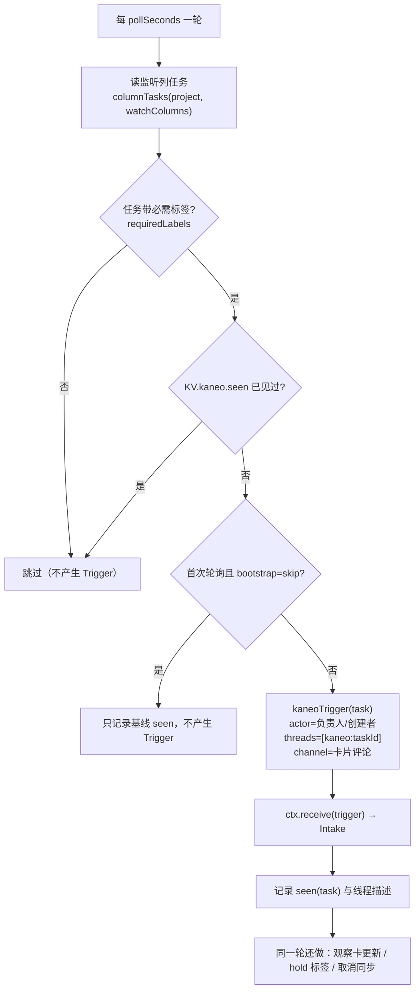

- **`bootstrap=skip`**：第一次看到的历史卡只登记、不接单；`bootstrap=trigger` 则把已有卡也当请求。
- **`KV.kaneo.seen`**：同一任务只产生一次 Trigger，之后靠“卡更新观察”产生增量 Input。
- **看板观察**（`observeUpdates`）：运行中工单的卡出现**评论/标题/描述/列**变化 → 生成更新 Trigger（`human=true`，`meta.update=true`）→ 作为 Input 送给同一工单的 Session，**不新开工单**。
- **hold 标签 / 取消列**：卡上 `holdLabel`（默认 `blocked`）存在时暂停投递、保留基线；移除标签 → `holdLifted` Trigger → 同一工单/同一 Session 恢复。卡进入 `cancelColumns` 或被删除（404）→ `ctx.cancel` → 工单 `stopped`。详见 [BLK.md](BLK.md)。

### 2.2 其他来源

- **ntfy**：轮询主题历史 → 每条消息调用 Kanban API 建卡（`to-do` 列）；卡进入看板后才走 Kanban 管道。
- **Gitea**：面板“测试连接”与实际健康检查都只校验 `charterRepository`；它不监听 Issue/PR，卡片的 `repo:owner/name` 才决定工单用哪个代码仓库。
- **MinIO**：`s3` 来源只做连通/桶探测与工具能力，不产生 Trigger。

---

## 3. 摄入 Intake：去重、过滤、扇出

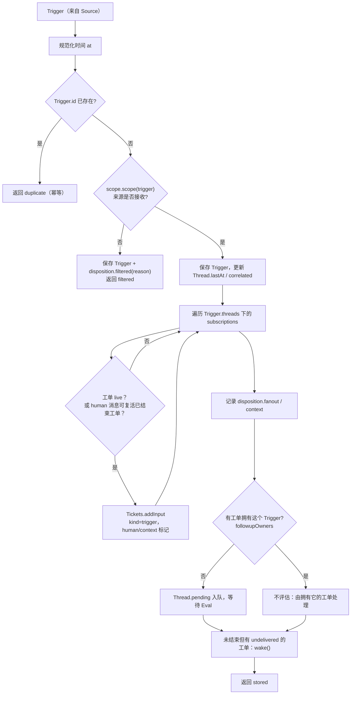

要点：

1. **先过滤再落库**：被来源拒绝的触发也会保存，并带 `filtered.reason`（面板“被过滤”可查）。
2. **fan-out 到订阅该 Thread 的工单**：人写的消息送到（live 工单，或非 human-stop 的已结束工单——后者进入“可复活”队列）。
3. **没有工单拥有时才评估**：`owners(trigger)` 为空才 `queueForEval`；否则它只是该工单的 follow-up Input。
4. **human 消息可复活已结束工单**：`Tickets.wake` 在下一轮 `evaluateDue` 中按当前 Policy 重新验证 Mandate；不通过则 `refuse`。

---

## 4. 评估 Evals：批量、语义强度、截止时间

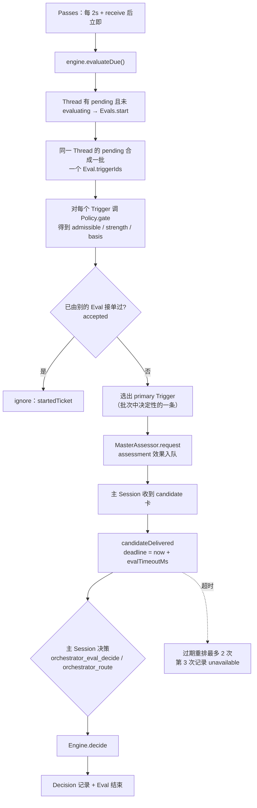

- **一个 Thread 一个 Eval**：批处理让“同一线程里连续几条消息”只产生一次研判。
- **截止时间从 candidate 送达算起**；`paused` 时暂停过期，恢复后 deadline 顺延。
- **过期**：重新排队（`REQUEUES=2`），第三次记为 `unavailable`（面板显示为问题，可 dismiss）。
- 主 Session 拿到的是**候选卡**：线程上下文（`threadContext`，含仓库/线程读取边界）、批次内其他触发、匹配规则与授权信息。

---

## 5. 决策：接不接、以什么强度接

### 5.1 准入 gate（先后顺序）

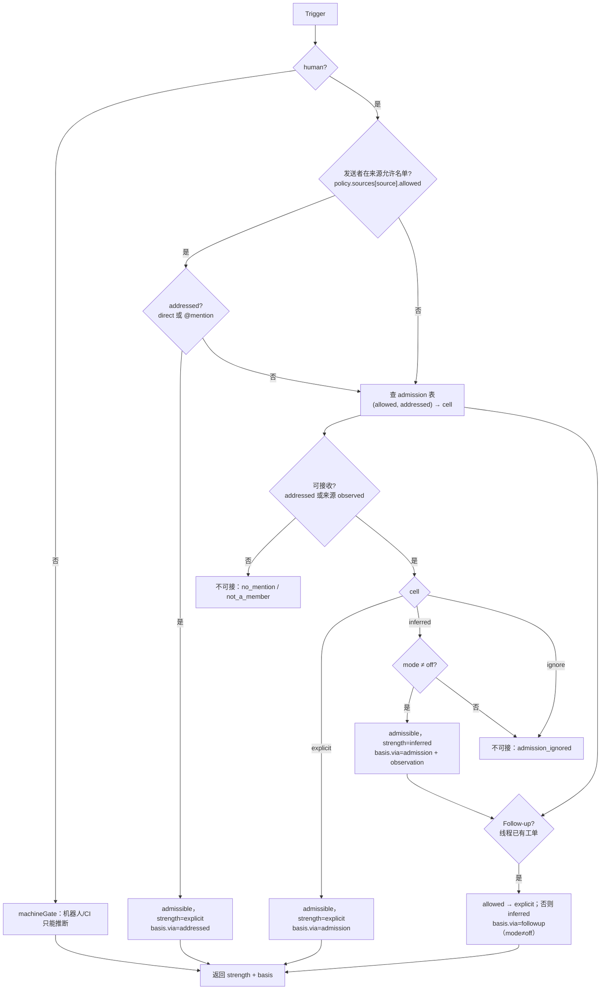

`Mandate.basis` 会记录 `source / scope / row / sender / rules / via`，用于后续**重新验证**（Policy 变化、工单恢复）。

### 5.2 评估换成 outcome

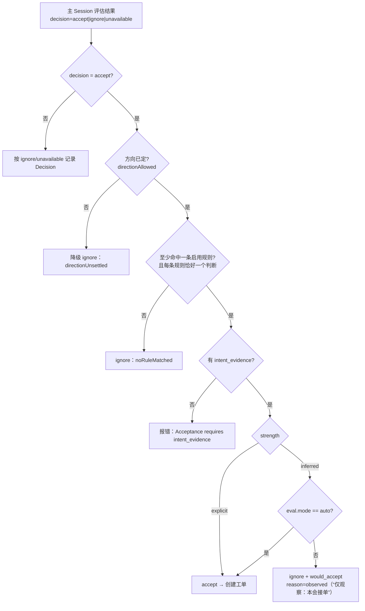

> **关键语义（常见误解）**：`off / observe / auto` 只决定**主动候选（inferred）**是否接单；
> **明确请求（explicit）在任何模式下都会按派工规则路由**（`src/policy.ts:55`、`src/app/prompts.ts:45`）。
> 因此“仅观察”下，看板卡进监听列仍会被接单——这是设计行为，不是漏拦。

### 5.3 常见 Decision reason

| reason | 含义 |
| --- | --- |
| `explicitRouted` | 明确请求，直接路由接单（Kanban 卡进监听列常见） |
| `observed` | 观察模式：本会接单，记为 `would_accept` |
| `startedTicket` | 该触发已经开过工单，不能重复接 |
| `timeout` | 评估超时（`unavailable`） |
| `policyChanged` | 评估期间 Policy 变了，重新评估/作废 |
| `noRuleMatched` / `directionUnsettled` | 规则未命中 / 方向未定 → 观察 |
| `not_a_member` / `no_mention` / `admission_ignored` | 来源过滤（面板可见） |

---

## 6. 接单：工单、授权、派工

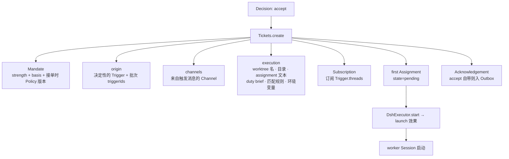

工单阶段（`ticketStage`，docs/003）：

| 阶段 | 条件 |
| --- | --- |
| `person:delivery` | 最近一次 Input 投递失败（`ticket.delivery`） |
| `person:answer` | 有 `attention` 问题 |
| `person:review` | 最新 report `ready`（等人验收/关闭） |
| `person:blocked` / `person:failed` | 最新 report 是 blocked/failed 且 **仍没有人**的消息 |
| `working:queued` | Assignment `pending` |
| `idle` | report `waiting`，或 Assignment 已结束 |
| `working` | 其余（有运行中的 Assignment） |
| `ended` | 有 `ended` |

工单生命周期：

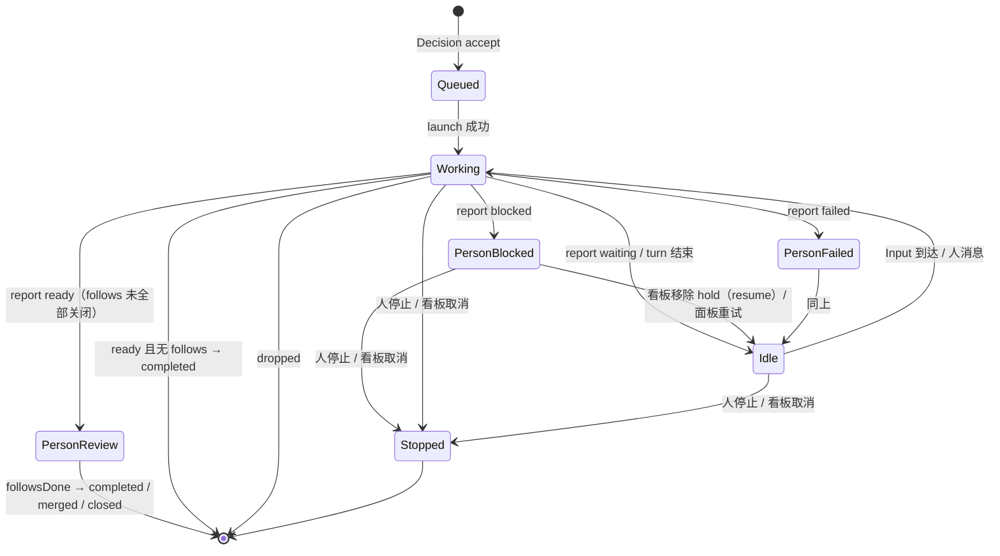

---

## 7. 看板卡的全链路时序（显式请求）

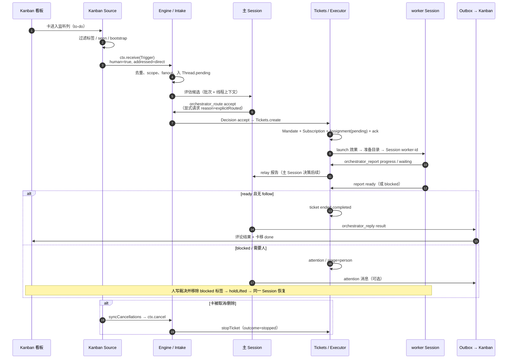

同一张卡在**运行中**被修改（评论/描述/列）时：`observeCards` 生成更新 Trigger → Intake → 该工单的 Input → `deliver` 效果 → worker 在同一条对话里读到，不新开工单。

---

## 8. 执行内部（DshExecutor）

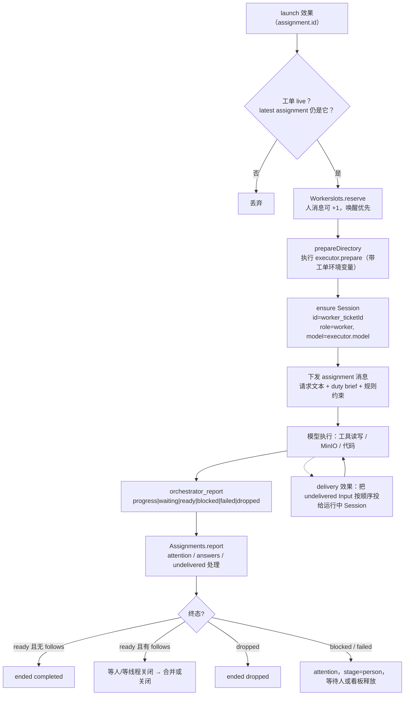

效果（`src/app/effects.ts`）关键语义：

| 效果 | 作用 | 失败行为 |
| --- | --- | --- |
| `assessment` | 把候选卡送进主 Session 并通知“已送达” | 2s 起指数退避 |
| `launch` | 准备目录、建 Session、发 assignment | 模型/网络瞬时错误重试 3 次；prepare 失败直接判失败 |
| `delivery` | 把工单的待投 Input 交给运行中 Session | 2s 起退避；记录在 `ticket.delivery` |
| `relay` | worker 报告/问题、人的 follow-up 送入主 Session | 保序，失败阻塞后续同类 |
| `notice` | 不唤醒主 Session 的提示 | 保序 |
| `reply` | Outbox 发送到来源 Channel | 5s 起退避；前面同会话消息失败会阻塞 |

---

## 9. 失败、等待与恢复

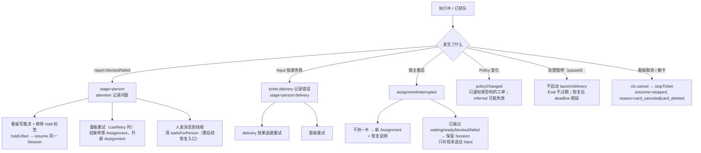

> **注意**：blocked/failed 工单收到人的消息后，`waitsForPerson` 变 false，但当前实现**不会**因此自动起新 Assignment；
> 受支持的恢复入口是**看板移除 hold 标签**（`holdLifted` → `Tickets.resume`）或**面板重试**。这条边界值得后续改造成“人类消息即恢复”。

---

## 10. 数据模型

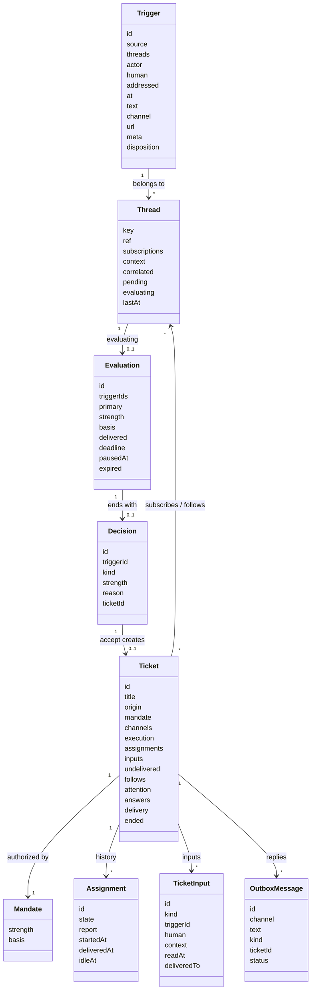

关键字段的用途：

- **`Trigger.disposition`**：记录了它到达了哪些工单、是否被过滤、被谁退还、被哪些工单认领。
- **`Thread.subscriptions`**：之后的触发会 fan-out 给这些工单；`context` 列出“只读上下文”的工单。
- **`Mandate.basis`**：`source/scope/row/sender/rules/via`，Policy 变化或工单复活时据此重新验证。
- **`Ticket.origin`**：开单的 Trigger 与批次；`execution` 决定 worker 目录与 assignment 文本；`follows` 决定 `ready` 何时真正结束工单。
- **`Assignment.report`**：最新报告（state/summary/at），`waitsForPerson` 与 `ticketStage` 都读它。
- **`TicketInput.readAt/deliveredTo`**：谁在什么时候把哪条输入交给 worker，用于面板与恢复。

---

## 11. 关键不变量与常见误解

| # | 不变量 / 事实 | 代码位置 |
| --- | --- | --- |
| 1 | 同一 Trigger 只存一次（幂等）；Kanban 同一任务只产生一次 Trigger | `core/intake.ts`、`KV.kaneo.seen` |
| 2 | 一个 Thread 同时只有一个 Eval；批次内触发共享强度与决策 | `core/evals.ts` |
| 3 | 一个 Trigger 最多开一个工单（`startedTicket`） | `core/evals.ts` |
| 4 | 每条启用规则必须恰好一个判断，accept 必须有 `intent_evidence` | `policy.ts` `assessmentOutcome` |
| 5 | `off/observe/auto` 只约束 **inferred**；**explicit 在任何模式都接单** | `policy.ts:55`、`app/prompts.ts:45` |
| 6 | `ready` 结束工单的前提是它跟随的 Thread 都已关闭；否则进入 `person:review` | `core/assignments.ts`、`core/tickets.ts` `followsDone` |
| 7 | 只有人写的消息能复活已结束工单；`cancel`/`stop` 不复活 | `core/tickets.ts` `wake` |
| 8 | 看板观察的更新走 Input，不新开工单；hold 标签是“暂停投递 + 释放后同 Session 恢复”的开关 | `sources/kaneo.ts`、`core/tickets.ts` `addInput` |
| 9 | 所有对外回复走 Outbox（幂等 id + 退避重试），失败会显示在面板 | `core/replies.ts`、`app/outbox.ts` |
| 10 | 面板的“仅观察”不是“全局暂停”；要全局停做用暂停/关来源/清监听列 | `policy.ts`、`docs/005-panel.md` |

---

## 12. 从代码读流程的入口索引

| 环节 | 入口 |
| --- | --- |
| 来源轮询与触发 | `src/sources/kaneo.ts` `pollRound` / `kaneoTrigger`；`src/sources/ntfy.ts`、`src/sources/gitea.ts`、`src/sources/s3.ts` |
| 摄入与扇出 | `src/core/intake.ts` `Intake.receive` |
| 轮次调度 | `src/app/passes.ts` `Passes.pump`、`src/core/engine.ts` `evaluateDue` |
| 评估批次与超时 | `src/core/evals.ts` `start` / `due` / `delivered` / `decide` |
| 候选送达与评估 | `src/app/assessment.ts`、`src/app/tools/main.ts`（`orchestrator_eval`、`orchestrator_route`） |
| 准入与判定 | `src/policy.ts` `gate`、`assessmentOutcome`、`revalidate` |
| 工单与授权 | `src/core/tickets.ts` `create` / `addInput` / `resume` / `retry` / `stop` |
| 执行 | `src/executor/dsh.ts` `start` / `deliver` / `launchQueued` / `prepare` |
| 报告与阶段 | `src/core/assignments.ts` `report`、`src/core/stage.ts` `ticketStage` |
| 回复与回写 | `src/core/replies.ts`、`src/app/outbox.ts`、`src/sources/kaneo-channel.ts` |
| 观察/阻塞/取消 | `src/sources/kaneo.ts` `observeCards` / `syncHoldLabels` / `syncCancellations`；[BLK.md](BLK.md) |

---

*本文只描述当前实现；图中“人/PM”指在 Kanban 或面板上操作的人。修改流程语义（例如让 observe 也拦明确请求）时，请同时更新本文件与 [docs/007-architecture.md](docs/007-architecture.md)。*
