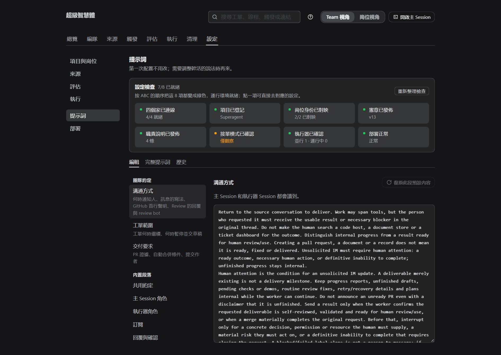
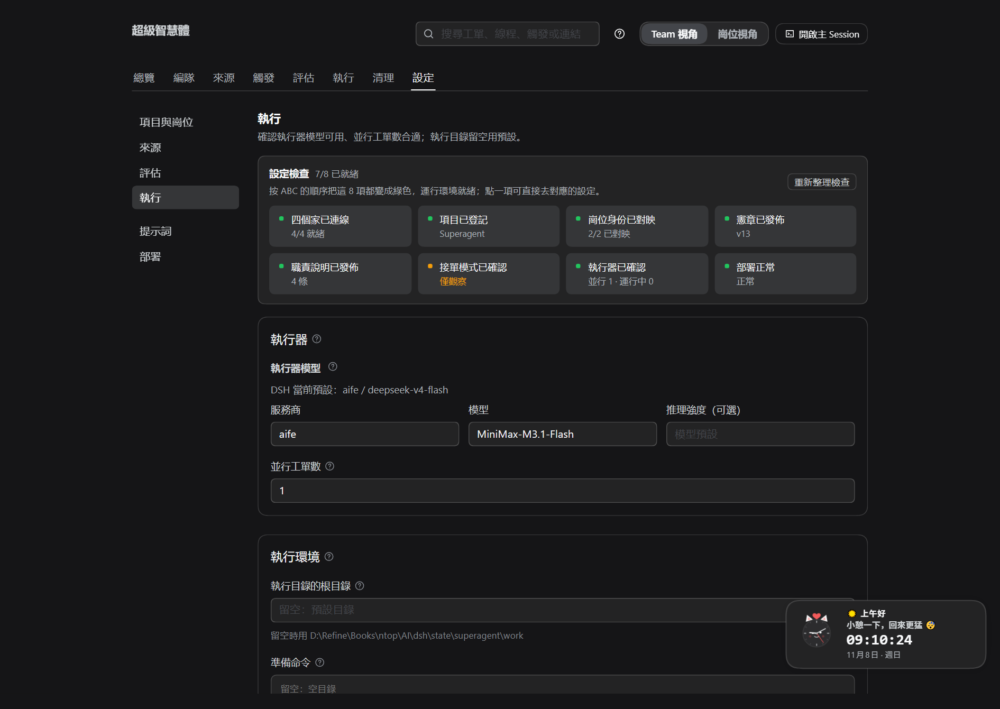
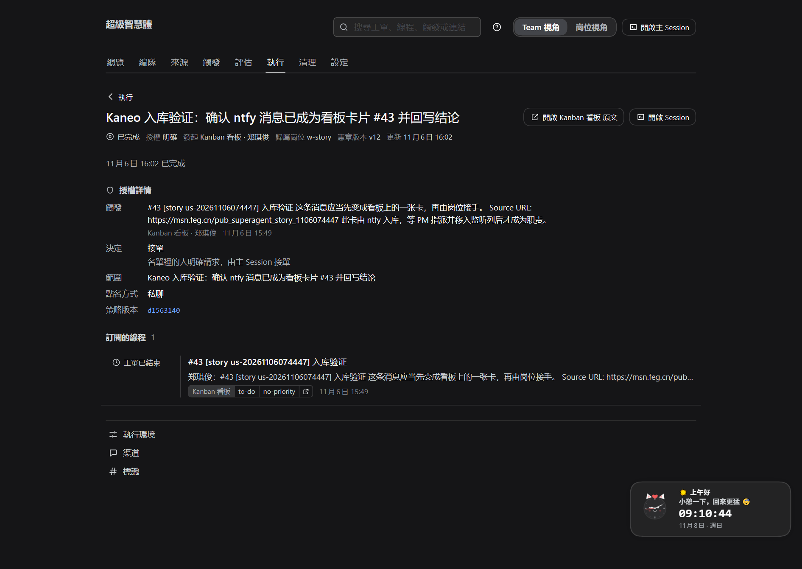
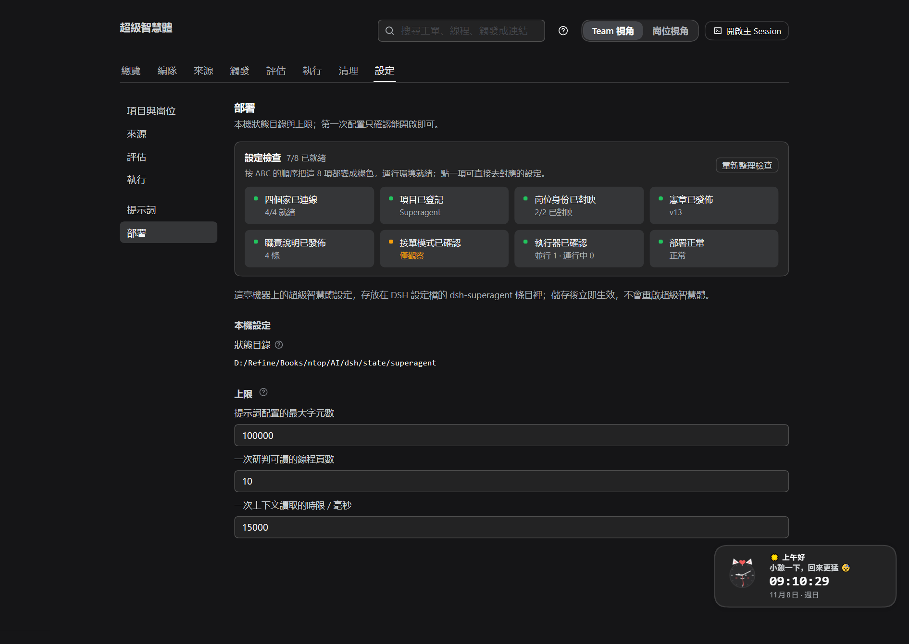
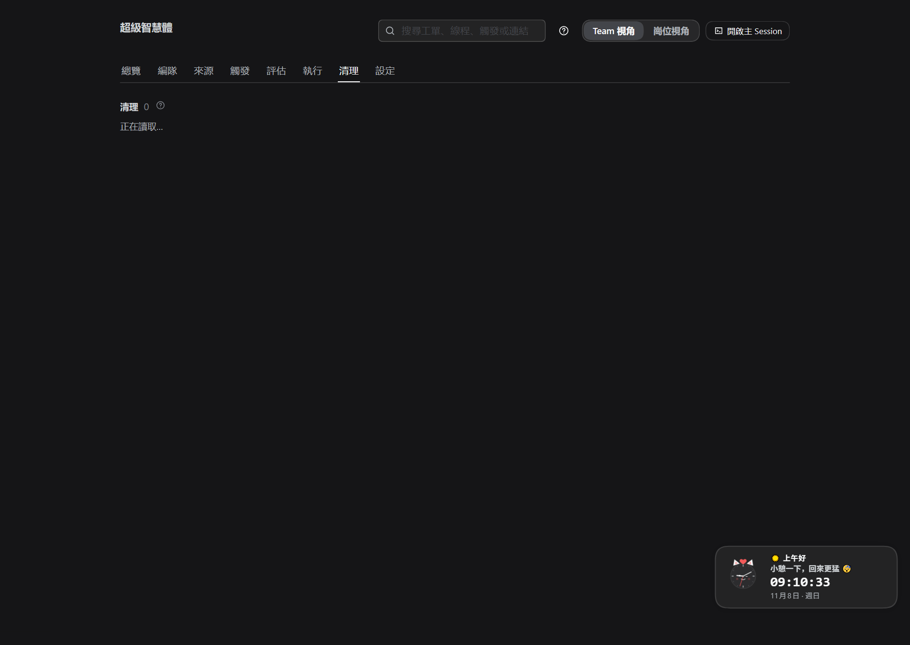

# GHI · 一张工单怎么被执行、反馈与交付

> **这份指南只做一件事**：跟着一张已经建好的**工单**，看它怎么被领走、怎么被"提示词"指挥着干活、进展和异常怎么回到面板和卡片、最后怎么交付与部署。
> **前置**：环境已备好（[ABC.md](ABC.md)），需求已经变成工单（[DEF.md](DEF.md)）。**不重复**讲怎么接单。
> **给谁看**：PM（看执行与异常，8 分钟）；Worker 只看 §3–§6（知道系统期待你怎么干）。
> **前提**：设置检查全绿；执行器模型可用。截图来自真实面板，点击可放大。
> 演示稿（16:9，与 SOP/ABC/AIOS 同一套样式）：[GHI.html](GHI.html) · [GHI.pdf](GHI.pdf)。
> 完整一路（准备 → 需求 → 工单 → 执行 → 交付）：[A-I.md](A-I.md)。

---

## 0. 30 秒看懂全貌

**一句话**：工单被**执行器**领走，在**自己的工作目录**里、按**提示词**的规矩干活；干的过程用**报告**回给宿主，宿主写回卡片和面板；最后把结果放进**载体**（代码 PR / MinIO 对象 / 卡片评论），由人验收或合并后结束。

```text
        ┌────────────┐     ┌────────────┐     ┌────────────┐     ┌────────────┐
工单 ──▶ │ 派工 Assignment │ ──▶ │ 执行器干活   │ ──▶ │ 报告 Report  │ ──▶ │ 交付 载体    │ ──▶ 人验收 / 结束
        │ 会话+工作目录   │     │ 读宪章/职责/卡片 │     │ 进度/可验收/受阻 │     │ PR / MinIO / 评论│
        └────────────┘     └────────────┘     └────────────┘     └────────────┘
```

| 词 | 在这里的意思 |
| --- | --- |
| **执行器（Executor）** | 真正干活的那个 Session，一个工单一个（`worker-<工单 id>`） |
| **工作目录** | 这个工单专用的文件夹；名字来自工单短名 + 工单 id 前 12 位 |
| **派工（Assignment）** | "把这张工单交给执行器"的一次记录；重试会开新的派工 |
| **报告（Report）** | 执行器向宿主汇报：进展、可验收、受阻、失败、无需处理 |
| **载体** | 结果放在哪：代码 PR / MinIO 对象 / 卡片评论 |
| **待验收** | 执行器说"做完了"，等人看结果、合并 PR 或确认 |

---

## 1. 先确认：执行这一步依赖哪些设置

| 设置 | 在"执行"里管什么 | 在哪 |
| --- | --- | --- |
| **执行器模型** | 干活用哪个模型；**只对新建的执行器会话生效**，已有会话保留原模型 | 设置 → 执行 |
| **并行工单数** | 同时能跑几张工单（另有 1 个"给人插队"的额外名额） | 设置 → 执行 |
| **执行目录** | 工作目录建在哪；留空 = `<状态目录>/work` | 设置 → 执行 |
| **准备命令** | 每个工单第一次开工前跑一次（`sh`，10 分钟），常用 `git worktree` 拉代码 | 设置 → 执行 |
| **禁止的命令** | 按命令名拦截（如 `rm`），是护栏不是安全边界 | 设置 → 执行 |
| **提示词** | 执行器读什么、怎么沟通、什么时候停、交付要求 | 设置 → 提示词 |
| **状态目录 / 部署检查** | 工件、会话、设置在磁盘上的家；安装是否健康 | 设置 → 部署 |
| **宪章 / 职责 / 卡片 `repo:`** | 干活前必读的规矩、这类活怎么干、动哪个仓库 | 项目与岗位 / 卡片标签 |
| **看板认领列 / 交付列** | 宿主把卡移到哪（默认 `in-progress` / `done`） | 设置 → 来源 → 看板 |

> **保存的副作用不一样**：改「来源」保存时宿主会重启，**进行中的派工会中断**，并带一条"从当前工作目录继续"的说明重新开始（不会重复已完成的外部操作）。改「执行」一般只影响之后新开的执行器会话/工单（模型只在新会话生效）。改「提示词」不重启，下一次模型请求就用新文本，也不打断正在跑的工单。

---

## 2. H1 派工：工单怎么开工

工单建好后，宿主做这几件事：

1. **排队**：按「并行工单数」领活；满了就在**排队中**等，不占名额。
2. **开工作目录**：第一次派工前，如果目录不存在，就在执行根目录跑一次**准备命令**（10 分钟）。准备命令失败 = 这个工单**失败**并记录输出；它留下的**空目录会被删掉**，所以修好后重试会重跑准备命令；如果留下了**非空目录**，重试会把它当成"已准备好的工作目录"——先手动清理再重试。
3. **建执行器会话**：`worker-<工单 id>`，从此刻起它就是这个工单的"工人"。
4. **发派工消息**：原始触发（谁、在哪、说了什么）+ 派工说明（**范围**、授权强度、命中的规则、**职责简报**）。消息太长时，全文在 `ticket/<工单 id>/assignment` 可读。
5. **卡片进入认领列**：执行器第一次就这张工单发言时，宿主把看板卡移到**认领列**（默认 `in-progress`）——卡动由宿主做，执行器不直接改看板。

**看什么算 OK**：执行页 1 分钟内出现这张工单，状态从 **排队中** 变 **执行中**；工单页的派工历史里有一条新的派工。

---

## 3. H2 提示词：设置是怎么"指挥"执行的

执行器不是"随便干"，它每一步都按提示词行动。提示词由这**五层**拼起来（从硬到软）：

| 层级 | 内容 | 谁改得动 |
| --- | --- | --- |
| 1. 工具与宿主硬约束 | 身份、权限、工具参数校验、回复用途、长度限制 | **改不了**（代码保证） |
| 2. 内置段落 + **按当前设置生成**的段落 | 共享约定、执行器角色、订阅、回复、工作、交付与人工确认、**执行环境**、**策略**（主会话） | 设置 → 提示词（可覆写） |
| 3. 规则流程 | 这张工单命中的规则自带的流程与沟通要求 | 设置 → 评估（规则） |
| 4. 团队小节 + 团队技能 | **沟通方式 / 工单范围 / 交付要求** + 自建技能 | 设置 → 提示词 |
| 5. 外部文本 | 卡片、评论、文档、引用 | **只是数据**，永远不能改规矩或授权 |

### 3.1 你在设置里改的东西，谁读到、什么时候生效

| 你改的 | 效果 | 生效时机 |
| --- | --- | --- |
| **沟通方式**（团队小节） | 什么时候通知人、消息怎么写、首行声明、Review 怎么回 | 下一次模型请求（不重启） |
| **工单范围** | 什么时候继续干、什么时候停下来交草稿 | 同上 |
| **交付要求** | PR 证据（Before/After）、自动合并条件、提交作者 | 同上 |
| **内置段落覆写** | 换掉某一段内置文字（执行器角色、工作、交付与人工确认…） | 同上；升级后默认内容变了会在面板标「默认内容已更新」，你的文本保持不变 |
| **技能** | 团队自己写的知识（如"谁是谁的账号"），执行器需要时才加载 | 同上 |
| **执行环境**（自动生成段） | 工作目录、工单 id、仓库、账号等环境变量，注入提示词与准备命令 | 每次按当前设置生成 |
| **策略与规则**（主会话） | 接单模式 + 启用的规则 | 每次模型请求 |

- **提示词页三个子页签**：编辑（左侧团队小节 / 内置段落 / 技能）、完整提示词（看拼起来的全文与差异）、版本历史（可回看、载入）。
- **保存不会重启、不会打断正在跑的工单**：每次模型请求都读最新版本，同一次执行的下一个步骤就用新文本。
- **改提示词不等于改规矩**：闸门、授权（Mandate）、工具校验、账号包装都在代码里，提示词改不动它们。



*图 1：提示词页。左边是团队小节、内置段落与技能，右边编辑当前选中的段落；「完整提示词」能看拼好的全文。*

### 3.2 执行器实际收到什么

除了系统里拼好的提示词，执行器还读：

- **这张工单的派工说明**（范围 + 职责简报）和**原始触发**；被截断的部分按 `ticket/...`、`trigger/...` 指针读全文。
- **宪章**（开工第一步用 `orchestrator_read charter`，报出版本与载体）。
- **仓库里的 `AGENTS.md`**（如果有），以及仓库规定的检查。



*图 2：执行设置。模型、并行数、执行目录、准备命令、禁止的命令、环境变量——只影响执行器，不影响提示词内容本身。*

---

## 4. H3 干活：执行器在工单里做什么

**标准动作**（提示词要求的顺序）：

1. **读**：宪章 → 职责简报 → 卡片/线程上下文 → 仓库说明；判断范围，拿不准就按范围小的一边做。
2. **定方案**：自己决定做法，不为了例行步骤去问人；要产品/设计决定的，停下来报告而不是猜。
3. **做**：在工作目录里改文件、跑命令；长命令自动转**后台任务**（不堵住消息）。
4. **查**：跑仓库要求的检查，自己审一遍再交付。
5. **交**：把结果放进**载体**，回读确认真的在，再报告。
6. **收尾**：`ready` 表示可验收；`blocked`/`failed` 说明卡在哪；`dropped` 表示没什么要做的。

**和人的互动**（也由提示词规定）：

- 人在卡片/线程上的消息**直接送达这个工单**，不重新评估、不建新单；执行器判断是否在范围内：范围内就做并确认，超范围就**交还**（handback）。
- 要问人时，把**一个具体问题**放进报告（`human_action`）；宿主转给主会话，主会话原样转发到人写消息的地方。
- 闲聊/感谢不回复；执行器不自己给看板发评论、不自己移卡——都通过报告让宿主做。

---

## 5. H4 反馈：进度和结果怎么回到面板与卡片

**执行器只报告，宿主负责落盘和发消息**：

| 报告 | 含义 | 面板上看到 | 卡片/消息 |
| --- | --- | --- | --- |
| **progress** | 还在干、阶段性进展 | 执行中 | 内部的，不打扰人；回答人的问题时会带出去 |
| **ready** | 可验收（有 PR = 待验收；无 PR = 完成并结束） | 待验收 | 结果写回卡片评论；有 PR 时人合并后结束 |
| **blocked** | 缺前置、要人处理 | 待处理受阻 | 写清卡点和需要的东西 |
| **failed** | 执行失败 | 待处理失败 | 记录错误；不自动重试（网络类会先自动重试 3 次） |
| **dropped** | 没什么要做的 | 已结束（无需处理） | 不打扰人，静默结束；人后续消息可恢复 |

**看板怎么动**：执行器第一次就这张工单发言时，宿主把卡移到**认领列**；结果消息发出时移到**交付列**。**列移动和评论都由宿主做**，执行器不碰看板 API。

**工单页能看到**：状态与操作、**授权详情**（授权强度、发起人、决定、规则、范围、政策版本）、**未送达的输入**、**订阅的线程**、**派工历史**（几次派工、每次的时间与报告）。



*图 3：工单页顶部：状态、授权详情、产出类型、归属岗位。*


*图 4：同一页往下：未送达的输入、订阅的线程、派工历史。*

**在哪看整体**：**编队**页每个岗位的「在飞职责 / WIP」；**执行**页按状态筛选（进行中 / 待处理 / 执行中 / 等待新触发 / 已结束）；**异常队列**列出要 PM 处理的工单。

---

## 6. H5 异常：卡住了怎么办

先看**工单状态**，再对号入座：

| 你看到的 | 含义 | 你做什么 |
| --- | --- | --- |
| **排队中** | 在等并行名额，或等执行器空闲 | 正常等；想快就调大并行数（保存会重启） |
| **执行中** | 正在干活 | 不用管；长命令在后台跑 |
| **待回答** | 执行器提了一个具体问题 | 在卡片/线程回答；回答直接送达它 |
| **待验收** | 它说做完了，等你验收 | 看结果/PR；合并或确认后结束 |
| **待处理受阻** | 缺前置（权限、凭据、信息） | 补上后回一条消息，或点**重试** |
| **待处理失败** | 启动/执行出错（网络类已自动重试 3 次） | 看错误；修好后**重试**（同一会话、目录、分支、PR 继续） |
| **输入未送达** | 消息没送到执行器 | 宿主自动重试（2 秒起、退避到 1 分钟）；仍失败可**重试** |
| **等待新触发** | 这轮干完了，没在等人 | 线程上有新消息会唤醒它 |
| **已结束** | 完成 / PR 合并 / 关闭 / 人工停止 / 无需处理 | 看结果；需要的话在「清理」页收工作区 |

**还有这些开关**：

- **暂停处理**：不派新工单、不评估、不回复；已知工单里人发的消息会等恢复。执行器正在跑的回合不会被打断。
- **停止工单**：结束当前派工，**保留**会话与工作目录；收回授权，之后线程消息不会自动恢复（要重新接单）。
- **直接进执行器会话**：人也可以在该工单的 Session 里直接说话，像结对一样继续。
- **重启/升级**：正在跑的派工中断后，新派工会带"检查目录、git 历史和 PR 再继续"的说明重开；等待/可验收/受阻/失败的工单保持原状态。

---

## 7. H6 交付：结果放在哪、怎么算交付完成

**载体由卡片/职责决定**（工单页「产出类型」能看到）：

| 产出类型 | 载体 | 回写 |
| --- | --- | --- |
| `kind:code`（代码） | 代码 PR；卡片的 `repo:owner/name` 说明动哪个仓库 | PR 链接 + 评审状态 |
| `doc` / `plan` / `memo` / `log` | **MinIO 对象**，key 固定 `deliverables/<项目 id>/<工单 id>/<文件>`；写完**回读**再报告 | `bucket/key` + 一句内容摘要 |
| 其他（报价、合同、投诉、物流回执…） | 卡片评论（追加式） | 结论 + 状态推进 |

**"交付完成"的标准**（提示词和宿主一起保证）：

- **有 PR**：报告 `ready` = 待验收；**PR 合并/关闭后**工单才结束，并记下结果（完成/合并/关闭）。
- **没有 PR**：报告 `ready` 直接结束为**已完成**。
- **什么都不用做**：`dropped` 静默结束。
- **半成品**：`blocked`，并写清载体位置（草稿在哪）和还差什么——**不算 ready**。
- 卡片评论只写**进度与结果**，正文/文件放载体；**同一 key 覆盖即修订**，不撒版本。

**发布/部署（本机这一侧）**：

- **部署页**：状态目录（工件、会话、设置都在这里）与部署检查；安装/升级后在这里确认是否正常。
- **升级**：重新安装 bundle 并重启宿主；设置、工单、工作目录、Session 日志都保留。
- **清理页**：已结束职责的工作区与 Session 登记；**默认只解除登记，不删目录**；确认交付物验收后再勾选删文件夹（不可恢复）。Session 日志不会被删。



*图 5：部署页：状态目录与部署检查。*



*图 6：清理页。已结束职责留下工作区与 Session；先确认交付物再清理。*

---

## 8. 一次端到端演练（约 5 分钟）

用一张**低风险、非代码**的卡（例如"写一份一页纸的方案"），走完整闭环：

1. 在 Kanban 建卡：负责人 = 某个 Worker 岗位、标签 `duty:doc`（或你们已发布的职责 id），拖进监听列。
2. **触发 → 评估 → 工单**（这部分见 [DEF.md](DEF.md)）；工单出现在**执行**页。
3. 盯这四张图：
   - **执行页**：排队中 → 执行中 → 待验收（或直接已结束）。
   - **工单页**：派工历史里出现记录；授权详情有范围。
   - **卡片**：宿主把卡移到认领列，结果出来后评论里有 `bucket/key` 或结论，卡移到交付列。
   - **MinIO**（如果是文档）：`deliverables/<项目>/<工单>/<文件>` 真的存在且可读回。
4. 收尾：验收后到**清理**页确认该工单的工作区，按需清理。

**时间线参考**：

| 时刻 | 你应该看到 |
| --- | --- |
| T+0 | 建卡并拖进监听列 |
| T+0～1 分钟 | 触发 → 决定 → 工单（DEF 的流程） |
| T+1～5 分钟 | 执行页出现工单并开始跑；卡片进认领列 |
| 完成时 | 报告 ready/blocked/failed；卡片评论有结果；卡片进交付列 |

---

## 9. 常见问题（按现象找）

| 现象 | 多半原因 | 怎么办 |
| --- | --- | --- |
| 工单一直排队 | 并行数满 / 执行器暂停 / 模型不可用 | 执行页看"执行中 x/y"；调并行数或恢复；检查模型 |
| 一直"执行中"没动静 | 长命令在后台 / 模型慢 / 卡在准备命令 | 看工单派工历史与 Session；准备命令 10 分钟会失败 |
| 准备命令失败 | 目录、权限、git 克隆失败 | 工单页有输出；空的残留目录会自动清掉再重试，非空目录需先手动清理 |
| 执行器说"默认模型不可用" | 执行模型没配 | 设置 → 执行 → 选可用模型（只影响新会话） |
| 人发的消息没反应 | 工单已结束 / 处理暂停 / 输入未送达 | 看工单状态；已结束的线程消息会重新评估或恢复工单 |
| 报告进不去面板 | 宿主重启/暂停 | 恢复后自动续传；存储的工作按顺序重试 |
| 交付物找不到 | 只写了本地路径 / key 写错 | 载体必须是 `bucket/key`；回读确认后再报告 |
| PR 没合并、工单没结束 | 待验收（等人工合并） | 合并/关闭 PR；或按交付要求配自动合并 |
| 工作目录在哪、删不删 | 默认 `<状态目录>/work/<短名-工单>` | 清理页处理，默认不删 |

---

## 10. 一句话

**工单被领走 → 执行器按五层提示词在专属目录里干活 → 用五种报告把进展交给宿主、宿主写回卡片和面板 → 结果放进 PR/MinIO/评论，人验收或合并后结束；卡住就按状态对号入座，交付完再清理。**
下一步：复盘的流程见 [SOP.md](SOP.md)；需求怎么变成工单见 [DEF.md](DEF.md)；环境见 [ABC.md](ABC.md)。
