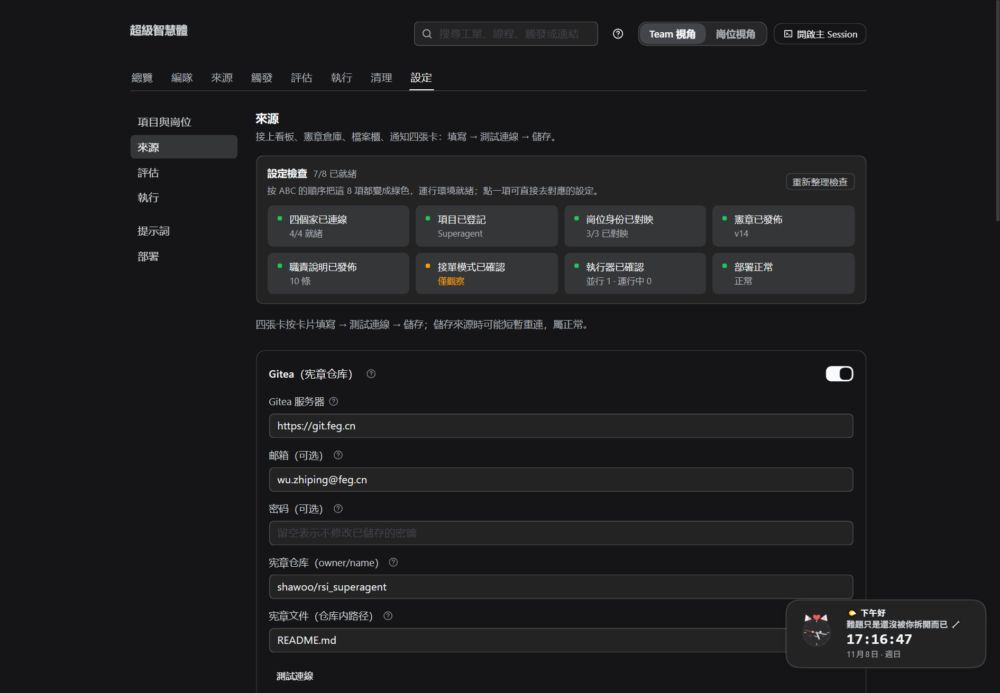
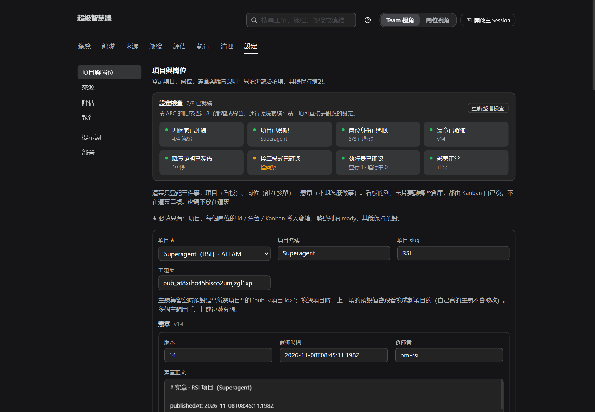
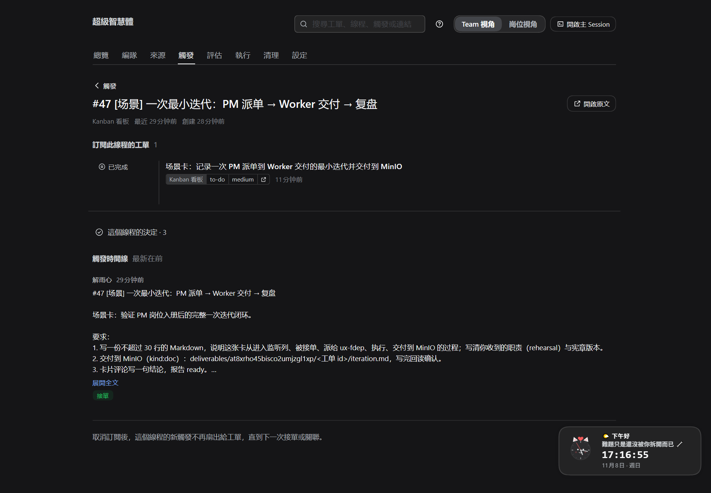
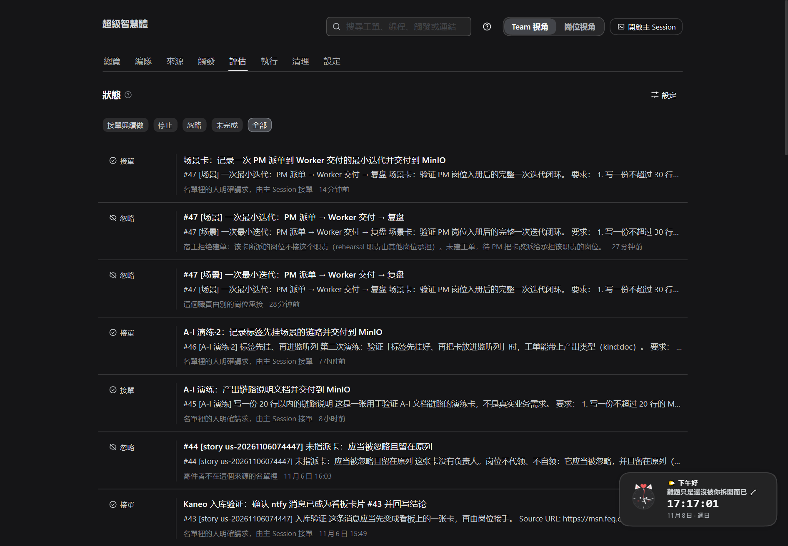
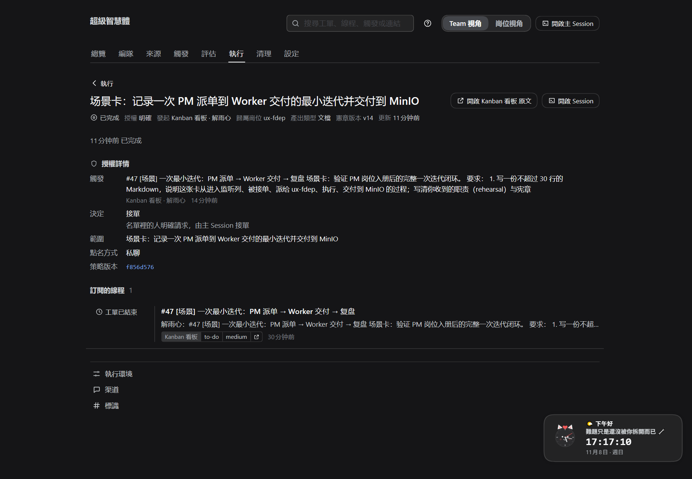

# INDEX · 根目录 PDF（8 份 · 151 页）

> 先看 **A-I.pdf** 第 1–3 页拿到全景，再按目标选一条路；不要从 SOP 细节开始。

## 三条路

| 目标 | 顺序 | 用时 |
| --- | --- | --- |
| 第一次跑通 | A-I → ABC → DEF → GHI | 约 2 小时 |
| 搭宪章 / 能力体系 | EA → ABC → A-I | 约 1.5 小时 |
| 理解设计 / 对外讲 | AIOS → STORY → A-I → EA | 约 2 小时 |
| 日常当手册 | SOP（细节回查 ABC/DEF/GHI） | 随用随查 |

## 8 份 PDF

| # | 文件 | 用途 | 页 |
| --- | --- | --- | --- |
| ① | [A-I.pdf](A-I.pdf) | 九节完整流水线 + 真实演练（先看） | 22 |
| ② | [ABC.pdf](ABC.pdf) | 把运行环境准备好（+ 建卡 4 条） | 16 |
| ③ | [DEF.pdf](DEF.pdf) | 需求怎么变成工单（触发 / 评估 / 闸门） | 16 |
| ④ | [GHI.pdf](GHI.pdf) | 工单怎么执行、反馈、异常与交付 | 21 |
| ⑤ | [EA.pdf](EA.pdf) | 宪章仓库 = 能力供给系统（PM 职责与路线） | 20 |
| ⑥ | [AIOS.pdf](AIOS.pdf) | 为什么这样设计（原则 / 边界 / 现状） | 18 |
| ⑦ | [SOP.pdf](SOP.pdf) | 日常操作手册（PM / Worker） | 22 |
| ⑧ | [STORY.pdf](STORY.pdf) | 用户故事：小吴的一天 | 16 |

**按问题找**：环境→ABC；卡为什么没接→DEF；工单卡住→GHI；复盘/知识/技能→EA；每天怎么干→SOP；讲给别人→STORY→AIOS。

**维护**：PDF 由同名 `.md` / `.html` 生成（`node scripts/build-<name>-deck.mjs`，再 `node scripts/html-to-pdf.mjs <name>.html <name>.pdf`）；新增或删除 PDF 时同步本表。演示版：[INDEX.html](INDEX.html) · [INDEX.pdf](INDEX.pdf)（1 页）。

---

## 实测：一次最小迭代（4 源 → PM 入册 → 派单 → Worker 交付 → 复盘）

> 2026-11-08 在本机真跑，不是示意：项目 id、宪章仓库、卡 #47 与工单都在面板/看板上可查。
> PM 的完整职责与来源设计见 [PM.md](PM.md)，能力供给路线见 [EA.md](EA.md)。

### 场景设定

| 项 | 本次取值 |
| --- | --- |
| 项目 id | `at8xrho45bisco2umjzgl1xp`（Kanban「Superagent」） |
| 宪章仓库 | `shawoo/rsi_superagent`（Gitea：README + `duties/`） |
| 4 个源 | Kanban（监听 `to-do`）、Gitea（宪章仓库）、ntfy（`pub_at8xrho45bisco2umjzgl1xp`）、MinIO（桶 `ateam`）→ **4/4 ready** |
| Team 两角色 | **PM** `pm-rsi`（1 个，WIP 2）+ **Worker** `ux-fdep` / `api-fdep` |
| PM 初始化 | 发布宪章 **v14**；发布职责 **10 条**（新增 `rehearsal → ux-fdep`）；PM 岗位入册并选中 5 条 `pm-*` 职责 |

**先有项目 id 与宪章仓库，再按顺序配 4 个源**（面板「设置 → 来源」，每张卡填完点「测试连接」→「保存」）：

| 源 | 必填 | 本次值 |
| --- | --- | --- |
| Kanban | 服务器、API key、项目 | `pl.feg.cn`（key 由本机存储记录读取）；项目 = 上面的项目 id；监听列 `to-do` |
| Gitea | 服务器、宪章仓库、宪章文件 | `git.feg.cn`；`shawoo/rsi_superagent`；`README.md` |
| ntfy | 服务器、主题 | `msn.feg.cn`；`pub_at8xrho45bisco2umjzgl1xp`（公开主题） |
| MinIO | 地址、桶、Access/Secret | 本机 MinIO；桶 `ateam`（密钥由本机存储记录读取） |

**再设两种角色**（面板「设置 → 项目与岗位」；每个岗位必须映射一个 Kanban 账号）：

| 角色 | 本次岗位 | 关键字段 |
| --- | --- | --- |
| PM | `pm-rsi` | 角色 PM、WIP **2**、监听 `to-do`、职责选 5 条 `pm-*` |
| Worker | `ux-fdep` / `api-fdep` | 角色 Worker、WIP 3、监听 `to-do`、职责 `ui`+`rehearsal` / `api` |

*图 1：四个源都已接通（Gitea / Kanban / ntfy / MinIO）。*

*图 2：Team 岗位——PM 一条 + Worker 两条；岗位身份 3/3 已映射，职责 10 条。*

### 迭代时间线（+08:00）

| 时刻 | 动作 | 结果 / 证据 |
| --- | --- | --- |
| 16:45:11 | PM 发布宪章 v14、职责 10 条 | Worker 开工读到的版本即 v14 |
| 16:47:31 | 建卡 #47（先放 `in-review`，不触发） | 卡号 #47 |
| 16:47:54–56 | 挂 `duty:rehearsal` + `kind:doc`，再移入监听列 `to-do` | 标签先挂、最后进列 |
| 16:48:48 | **第一次决定：忽略（dutyUnsupported）** | 闸门真实拦截：`ux-fdep` 的职责下拉只有 `ui`，没接 `rehearsal` |
| 16:49:31 | 主 Session 把拒绝原因写回卡/线程 | 提示"待 PM 把卡改派给承担该职责的岗位" |
| ~17:02 | PM 修正岗位–职责映射（`ux-fdep` 增加 `rehearsal`）并 requeue | 人工 13 分钟，正是复盘要改进的点 |
| 17:03:20 | 决定：**接单**（explicitRouted） | 触发被重新受理 |
| 17:03:25 | 派工给 `ux-fdep`，worker 会话开工 | 读宪章 v14 + duty brief |
| 17:05:36 | 写 MinIO `deliverables/<project>/<ticket>/iteration.md` | 1928 字节，已回读 |
| 17:06:13 | 报告 `ready` → 工单 completed | 执行耗时 **2 分 53 秒** |
| 17:06:23 | 卡片评论回写 `bucket/key` 与结论 | 卡进入 `done` |

*图 3：触发页里的场景线程（含第一次拒绝与后续接单）。*

*图 4：评估页——先 `dutyUnsupported` 忽略，PM 修映射后 `explicitRouted` 接单。*

*图 5：工单页——归属 `ux-fdep`、产出类型「文档」、宪章 v14。*

*图 6：工单下部——授权、派工历史与 ready 报告。*

### 实测数据（可复核）

| 指标 | 值 |
| --- | --- |
| 决策 | 2 次忽略（`dutyUnsupported` / 说明）+ 1 次接单（`explicitRouted`） |
| 工单 | `0c83ceb958a64a8de82d744a3414ca8e`，归属 `ux-fdep`，结束 completed |
| 执行耗时 | 2 分 53 秒（17:03:20 → 17:06:13） |
| 端到端 | 18 分 42 秒（16:47:31 → 17:06:13，含人工修映射与 requeue） |
| 交付物 | `ateam/deliverables/at8xrho45bisco2umjzgl1xp/0c83ceb9…/iteration.md`，1928 B，`minio_read` 回读一致 |
| 卡片 | #47 `done`，2 条评论（确认 + 结果），评论含 `bucket/key` |
| 闸门 | 命中 1 次真实拦截（岗位未承接职责），修映射后放行 |

### 手动复盘（这次手动做，方法与细节记录在案）

- **为什么手动**：定时复盘依赖外部调度桥（cron → ntfy → 卡 → PM），这次先手动验证一轮，再决定是否自动化。
- **方法**：面板 API 取时间线（threads / decisions / tickets）→ MinIO 回读交付物 → Kaneo 取卡片状态与评论 → 按 EA 的复盘门槛写结论（有数据、≤3 条改进、Owner+期限）。
- **做得好**：闸门拦住错误映射，没有乱建单；requeue 后一次通过；worker 自读宪章 v14 并回读交付物。
- **问题**：PM 初始化漏了"岗位–职责映射"这一步（`rehearsal` 未加到 `ux-fdep` 下拉），首次被闸门拒绝。
- **改进（≤3，Owner / 期限）**：
  1. PM 初始化清单加"岗位–职责映射核对"——PM，本周；
  2. 建卡前先对照 `duty:<id>` 与目标岗位职责自检——PM，立即；
  3. 复盘定时化：cron → ntfy → 卡 → `pm-retro-curator`——PM，P1。
- **结论**：一次完整闭环成立；唯一人工卡点是"初始化映射"，已作为第一条复盘改进。

### 复盘自动化路径（本次未启用）

现在可以手动；自动化只要把「消息 → 卡 → 工单」接上：Windows 任务计划/CI 定时向 ntfy（tag `dsh`）发「日/周/月复盘」，ntfy 来源入库成卡；若 PM 岗位映射宿主账号，卡直接进 PM 队列，由 `pm-retro-curator` 产出 `reviews/` 与最新复盘总结。具体字段与职责见 [PM.md](PM.md) §4。

> 复现入口：场景截图脚本 `scripts/capture-scenario-shots.mjs`；卡 #47 / 工单 `0c83ceb958a64a8de82d744a3414ca8e` / 宪章 v14 均保留可查。
