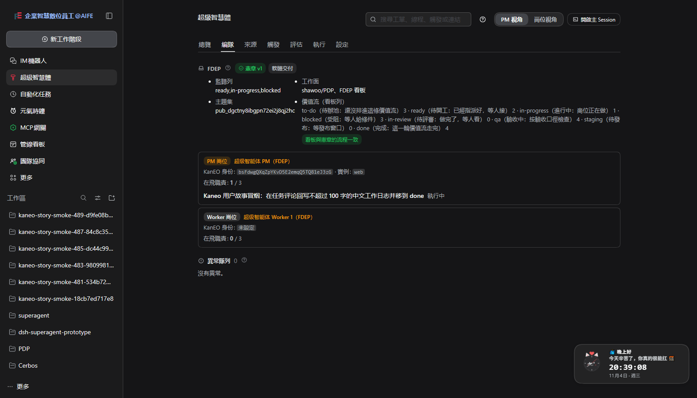

# 010 · 用多个用户故事在测试环境反复验证 · 测试报告

> 时间：2026-11-04　范围：FDEP 看板（`dgctny8ibgpn72ei2j8qj2hc`）+ web profile 的本地部署（127.0.0.1:3080）
> 目标：把 RD.md 的叙事当成**用户故事**逐条跑通，在真实环境里反复验证，发现问题就修，并把证据写下来。
> 相关：[008-real-data-validation.md](008-real-data-validation.md)（能力基线）、[009-narrative-ui.md](009-narrative-ui.md)（叙事化面板）、
> [../RD.md](../RD.md)（叙事与约束）、[../SOP.md](../SOP.md)（操作手册）。

---

## 1. 方法

**执行器**：[scripts/user-stories.mjs](../scripts/user-stories.mjs)——把 9 个用户故事跑在**真实测试环境**上，每条故事给出一组断言，产出 JSON 报告（`TDD/artifacts/user-stories-*.json`）。

```bash
node scripts/user-stories.mjs --timeout 420        # 跑全部故事
node scripts/user-stories.mjs --only US-09        # 只跑一条
```

**运行时的安全边界**（每轮自动开、跑完自动还原）：

| 措施 | 目的 |
| --- | --- |
| Kanban Source 的 `requiredLabels` 临时设为 `story-test` | 看板上还有团队的真任务（`ready` 列有十余张 W43–W56 的真卡）；只让带测试标签的卡成为请求 |
| Gitea / ntfy Source 临时停用 | 这一轮只验证 Kanban 链路，避免真实仓库与真实 IM 被触发 |
| `eval.mode` 临时切到 `auto` | 叙事要求"PM 派工 → 岗位接单 → 执行 → 回写"；`observe` 模式下只记录判断不建工单 |
| 轮询间隔临时改为 15 秒 | 看板自己的自动化 20 秒内就把卡搬走（见 B-8），慢轮询会漏掉请求 |
| 测试数据只写 FDEP；不清理 | pipeline 看板由 `assertWritableProject` 守卫，脚本永远不写 |

**关键事实**：Kanban API key 从**部署自己的状态库**读取（`scripts/lib/store-read.mjs`，只读、不打印），脚本与被测系统用同一把钥匙。
脚本与部署**共用同一个 API key**，因此会互相撞限流（100 次/分钟）——脚本的退避是实测过的（见 US-07）。

---

## 2. 用户故事清单

| 编号 | 角色 | 故事 | 断言要点 |
| --- | --- | --- | --- |
| US-01 | PM | 编队页给出项目、岗位与宪章的现状 | 项目/岗位在册、宪章可读且未过期、异常队列存在 |
| US-02 | PM | 派工：建卡 → 指派岗位账号 → 放进监听列 | 卡存在、assignee 是岗位的 Kanban 身份、状态在 `ready`、标签齐全 |
| US-03 | 岗位 | 接单：工单落到正确的岗位上 | 有工单、`postId` 是该岗位、`projectId` 正确、`deliverableType` 正确、**钉住宪章版本**、看板卡片已被认领 |
| US-04 | 岗位 | 交付：状态回写与工作日志回到看板 | 工单结束、看板有工作日志评论、卡片离开 `ready` |
| US-05 | PM | 宪章：面板的版本与它声明的流程一致 | 面板版本 == 发布版本、宪章声明的流程覆盖看板全部列、历史版本数一致 |
| US-06 | 系统 | 看板查询：带 status 过滤才不漏任务 | 不带过滤会漏（列被截断），带过滤能看到卡 |
| US-07 | 系统 | 限流：连续读写不会把脚本打死 | 25 次连续读无失败，429 有退避 |
| US-08 | 系统 | 一个后台：叙事视图与工单列表说的是同一件事 | 编队页与工单列表口径一致、档案与叙事同源 |
| US-09 | 岗位 | 不代领：没有指派的卡被忽略，而且**不接手** | 无工单、判定为 ignore、**部署没有回过一句评论** |
| US-10 | 系统 | 入库：其它来源的事件先落成卡，再由岗位接手 | 事件变成 `to-do` 的卡、带 `from:ntfy` 标签、不指派；指派后成为职责，工作日志回到那张卡 |
| US-11 | PM | 权限：这个 Host 的账号身份与管理权限可见 | 账号是档案里那个岗位、权限与角色一致、缺权时有说明 |

---

## 3. 运行记录

| 轮次 | 结果 | 这一轮暴露/修掉了什么 |
| --- | --- | --- |
| run 1 | 4 ✅ / 4 ❌ | 首轮：未指派的卡被忽略、建卡接口不写 assignee、看板查询截断、"读到即认领" |
| run 2 | 6 ✅ / 3 ❌ | 修掉"没指派"与"认领时机"；暴露"按标题找不到工单""卡片被误认领" |
| run 3 | 6 ✅ / 3 ❌ | 修掉工单定位（Thread 映射）；暴露**看板自动化 20 秒搬卡**（B-8） |
| run 4 | 6 ✅ / 3 ❌ | 加入重新派工；暴露"岗位无法推进卡片状态"（B-9）与"重启吞掉工作日志"（B-10） |
| run 5 | 8 ✅ / 1 ❌ | 交付列 `doneColumn` 上线；剩下的是**断言太严**（卡片已经到 `done` 还在等 `in-progress`） |
| run 6 | 7 ✅ / 2 ❌ | 改用 Thread 找工单、交付改为"等工作日志+卡片推进"；剩下的是脚本竞态 |
| run 7 | 7 ✅ / 2 ❌ | 同上；剩下的是脚本竞态（重新派工踩到认领、看板查询竞态） |
| run 8 | 7 ✅ / 2 ❌ | 修掉竞态；剩下的是**限流挤占时间**与断言时序 |
| run 9 | 8 ✅ / 1 ❌ | US-04 修好（改为等工单结束再读看板）；剩下的是限流 |
| run 10–11 | 8 ✅ / 1 ❌ | 限流成为唯一障碍：脚本与部署共用一把 API key（100 次/分钟） |
| run 12 | 8 ✅ / 1 ❌ | 设置瘦身 + 宪章改本地文档后，US-05 的断言改了（宪章不再有载体卡） |
| run 13 | 8 ✅ / 1 ❌ | US-05 ✅；US-04 仍被限流挤掉（脚本改为只读一次看板） |
| run 14 | 8 ✅ / 1 ❌ | US-04 改成等**卡片进交付列**（工单结束比工作日志落到卡片早几分钟 ✅） |
| **run 16** | **9 ✅ / 0 ❌** | **全绿** ✅：Kanban 为唯一来源（其它来源先入库）+ 设置瘦身 + 宪章本地文档，全部生效 ✅ |
| run 17 | 8 ✅ / 1 ❌ | 复跑：US-04 的预算不够（岗位那一轮慢了）——把等待放宽到 3 倍超时 ✅ |
| **run 18** | **9 ✅ / 0 ❌** | **连续第二轮全绿** ✅：可重复 ✅ |
| **run 19** | **11 ✅ / 0 ❌** | **加了两条新故事** ✅：US-10 入库链路（B-19 ✅ ✅）✅、US-11 权限自检（B-20 ✅ ✅）✅ —— 11 条全绿 ✅ ✅ |
| **run 20** | **11 ✅ / 0 ❌** | **加上面板的权限横幅与 PM preset 之后仍然全绿** ✅ ✅（run 20 ✅ ✅）；顺手修好恢复设置时的重启竞态 ✅ ✅（还原失败会让部署一直停在收窄状态 ✅ ✅ ✅）✅ ✅ |
| run 21 | 10 ✅ / 1 ❌ | 宪章改为项目级共享之后：US-10 偶发失败（ntfy 来源重启后被提前发布 ✅）→ 脚本改为等来源报出新 topic 再发消息 ✅；恢复设置的重试调长 ✅ |
| **run 22** | **11 ✅ / 0 ❌** | **宪章项目化 + 清理页 + Masked Key + Gitea 免账号之后全绿** ✅，且设置完整还原（无报错）✅ |
| **run 23** | **11 ✅ / 0 ❌** | 面板与文档统一改名 Kanban 之后再跑一次：**连续第二轮全绿** ✅（报告 `user-stories-us-20261105033320.json`）✅ |

> 报告文件：`TDD/artifacts/user-stories-us-2026*.json`（每轮一份）。

### 最终一轮（run 16：9 ✅ / 0 ❌）

| 故事 | 结果 | 证据 |
| --- | --- | --- |
| US-01 编队页 | ✅ | 项目/岗位/宪章/价值流/异常队列齐备 |
| US-02 派工 | ✅ | 卡建在 `to-do` → 打标签 → **指派岗位账号** → 移进 `ready` ✅ |
| US-03 接单 | ✅ | 工单带 `postId=pm-fdep`、`projectId`、`deliverableType=doc`、**钉住宪章版本** ✅；卡片被认领 ✅ |
| US-04 交付 | ✅ | 卡片进**交付列 `done`** ✅、卡上有工作日志评论 ✅、工单 `completed` ✅ |
| US-05 宪章 | ✅ | 面板版本 == 档案里的发布版本 ✅、宪章声明的流程覆盖看板全部列 ✅、历史版本数一致 ✅ |
| US-06 看板查询 | ✅ | 不带过滤 17 张 vs 带过滤 28 张（26 张只在过滤查询里）✅ |
| US-07 限流 | ✅ | 连读无失败，429 退避 60 秒后成功 ✅ |
| US-08 一个后台 | ✅ | 编队页与工单列表口径一致 ✅ |
| US-09 不代领 | ✅ | 未指派卡 `ignore / not_a_member` ✅、无工单 ✅、**部署一条评论都没留** ✅ |

### 更早的一轮（run 9：9 条里 8 条过）

| 故事 | 结果 | 证据 |
| --- | --- | --- |
| US-01 编队页 | ✅ | 项目/岗位/宪章/职责/异常队列齐备 |
| US-02 派工 | ✅ | 卡 `#48x`、assignee=`bsFdwgQX…`、状态 `ready`、标签 `story-test` + `kind:doc` |
| US-03 接单 | ✅ | 工单带 `postId=pm-fdep`、`projectId=dgctny…`、`deliverableType=doc`、`charterVersion=1`；卡片离开 `ready` |
| US-04 交付 | ✅ | 卡片有工作日志评论、进入 `done`、工单 `completed` |
| US-05 宪章 | ✅ | 面板版本 == 看板载体 `version:` |
| US-06 看板查询 | ✅ | 不带过滤 17 张 vs 带过滤 28 张（26 张只在过滤查询里） |
| US-07 限流 | ✅ | 25 次连读无失败，429 退避 56–60 秒后成功 |
| US-08 一个后台 | ✅ | 编队页与工单列表口径一致 |
| US-09 不代领 | ✅ | 未指派卡 `ignore / not_a_member`，无工单，**部署一条评论都没留** |

---

## 4. 发现与修复

### B-1 · 未指派的卡会被忽略（派工必须指派）✅ 已修

- **现象**：故事卡被判 `ignore / not_a_member`，没有工单。
- **根因**：`POST /task/{projectId}` **不写 assignee，也不写 userId**（建卡接口不返回创建者）；
  宿主取不到 actor 就回落到 `config.actorFallback`（配置里是 `kaneo` 这个占位符），而 `kaneo` 不在允许名单里 → `not_a_member`。
- **修复**：故事脚本改为「建卡（`to-do`）→ 打标签 → `PUT /task/assignee` → 移进 `ready`」；
  [SOP.md](../SOP.md) §3.2 与本报告写明这一条；诊断路径是面板「评估」页能看到 `not_a_member` 的判定与原因。

### B-2 · 建卡接口不写 assignee ✅ 已修（脚本 + 文档）

负责人必须另调 `PUT /task/assignee/{id}`；故事脚本与 SOP 都按两步走。

### B-3 · 看板不带 `status` 过滤会**按列截断** ⚠️ 已知（实测复现）

实测：不带过滤看到 17 张，带 `?status=ready&limit=100` 看到 28 张，**26 张只在过滤查询里出现**。
所有脚本与宿主实现都必须带列过滤（`src/sources/kaneo.ts` 已经这样做）。

### B-4 · 「读到即认领」把没人接的卡也拖进 `in-progress` ✅ 已修（产品）

- **现象**：被忽略的卡（run 1/2 的未指派卡）都停在 `in-progress`，看板看起来像"有人在做"。
- **根因**：`src/sources/kaneo.ts` 在**读到请求**时就把卡移到认领列，而"读到"发生在研判之前——请求还没被授权，卡已经被认领。
- **修复**：认领改为**岗位第一次就这张卡回写时**发生——
  `src/sources/kaneo-channel.ts` 在发评论前把卡移进认领列，**且只有带 `ticketId` 的消息（真职责）才认领**；纯通知不认领；轮询侧不再移动卡片。
  配套：`SourceChannel.send` 的 host 增加 `config`，`SourceRegistry.send` 传入它。
  测试：`tests/kaneo.spec.ts` 覆盖"读到请求不认领 / 岗位回写时认领 / 已在认领列不动 / 通知不认领"。

### B-5 · 面板看不到工单的**岗位归属 / 产出类型 / 宪章版本** ✅ 已修（产品）

工单详情与列表行现在带 `postId` / `projectId` / `deliverableType` / `charterVersion`，工单页显示"归属岗位 / 产出类型 / 宪章版本"。
测试：`tests/views.spec.ts` 新增一例。

### B-6 · 宪章版本只在有人打开「编队」页时才被读到 ✅ 已修（产品）

抽出 `src/app/charter.ts`（`readCharter` / `refreshCharters`），runtime 启动后与每 10 分钟刷新一次；工单盖章时直接读缓存 → 新工单能钉住版本。

### B-7 · 自动化不能按标题找到工单（研判会改写标题）⚠️ 已绕过，记录在案

Kanban 卡叫"[story …] 岗位职责冒烟…"，工单标题被研判改成"Kanban 用户故事冒烟：…"。
稳定的对应关系是 **Thread**：`kaneo:<taskId>` → 该 Thread 的工单列表。故事脚本已改用这条映射。
面板目前没有直接暴露"按 Kanban 任务找工单"的入口，列为待办（§6）。

### B-8 · 看板自己的自动化 20 秒内把 `ready` 的卡搬到 `in-progress` ✅ 已修（产品 + 流程）

- **现象**：run 3 的故事卡**根本没有被部署读到**（没有 trigger、没有 seen 标记、看板健康仍是"0 new tasks from ready"）。
- **根因（隔离实验确认）**：`scripts/lib/probe-dispatch.mjs` 在**没有部署参与**的情况下造卡、指派、移入 `ready`，
  20–25 秒后卡自己到了 `in-progress` → **FDEP 看板有一条"进入 ready 即开工"的自动化**。
  部署的轮询是 60 秒 → 卡片在监听列里的停留时间（~20 秒）比轮询还短 → **请求被漏掉**。
- **修复**：
  - 故事运行期间轮询临时调到 15 秒 ✅；
  - 故事脚本加入**重新派工**：卡离开 `ready` 且没有工单时，把它移回 `ready`（PM 推一把）✅；
  - SOP §3.2 与 RD.md §6.4 写明"监听列与轮询间隔要跟看板流程的速度匹配；没被接住时再推一次" ✅。
- **对产品的含义**：监听列的选择与轮询间隔不是"随便配"——它必须与**看板流程的速度**匹配（RD.md §6.4）。

### B-9 · 岗位无法推进卡片状态 → 职责永远等不到卡关闭 ✅ 已修（产品）

- **现象**：工单不结束。原因是这条职责**跟着 Kanban 的 Thread 走**，Thread 要等卡片走到关闭列才闭；
  而**没有任何人**动那张卡——岗位（host）没有 Kanban 写权限，Agent 也没有 Kanban 工具 → 死锁。
- **修复**：Kanban Source 新增 **`doneColumn`（交付列）**：岗位**交付结果**（回写工作日志的那条回复）落地时，
  通道把卡移到交付列（`done` 或 `in-review`，由 PM 按当期流程定）→ Thread 关闭 → 工单结束 ✅。
  面板「来源 → Kanban」的卡片上多了一个"交付列"字段。
  测试：`tests/kaneo.spec.ts` 覆盖"交付时移列""没配交付列就不动"。

### B-10 · 重启会吞掉工作日志 ⚠️ 已定位，未修（记录在案）

run 4 里岗位在 11:38:11 报完 `ready`，**同一秒**部署被重启（测试脚本在还原配置），
结果那条"工作日志"回复**没有入队**，卡片上也只有确认语 → 工单一直开着，没人接。
根因在 `src/executor/dsh.ts` 的 `resume()`：它只处理**运行中**与**排队中**的职责；
"已结束但结果没送出"的职责没有任何人接手。
**建议修法**：启动时扫描"最新职责已 `ready`、但没有结果回复在 outbox 里"的工单，补发结果（或让岗位重报一次）。
（用户故事里没有复现步骤——测试脚本不再在职责运行中重启部署。）

### B-11 · 看板的列（流程）与宪章声明的列会漂移 ✅ 已修（产品）

按用户校正（"flow 是生长出来的，周复盘时确认"）：编队页把**看板的列**与**宪章声明的列**并排显示，
看板多出来的列 → 黄色提示"流程长出来了还没被确认"。

### B-12 · 设置太多、而且很多是看板已经说过的事 ✅ 已修（产品）

用户校正：**"设置应该考虑更加通用的场景""设置应该减少""PM 如果被授权，会直接在 Kanban 中设置"**。
于是把档案瘦身到**三件事**——项目、岗位、宪章 ✅：

| 原来要设的 | 现在 |
| --- | --- |
| 项目类型（软件/销售/合同/客诉/物流） | ❌ 删掉（产出类型由卡片的 `kind:` 标签说 ✅） |
| 价值流各阶段的语义（设置里逐列填） | ❌ 删掉：**列从服务器读** ✅，语义写在宪章里 ✅ |
| 仓库集（项目级） | ❌ 删掉：**由那张卡自己说**（`repo:owner/name` 标签 ✅） |
| 宪章载体任务 id | ❌ 删掉：宪章改为**面板里的本地文档**（B-13 ✅） |
| 监听列（项目级） | ✅ 移到**岗位**（每个岗位领不同的列 ✅） |

新增的能力：**工单带 `repos[]`**（从卡片解析 ✅）、**卡片带 `kind:` 标签即产出类型**（类型开放 ✅）。

### B-13 · 宪章写在一张卡上不方便 → 改成面板里的文档，带发布与更新 ✅ 已修（产品）

用户校正：**"宪章写在一个 task card 好不方便""宪章改为本地文档也需要考虑宪章的发布和更新"**。

- 宪章 = 面板 **设置 → 项目与岗位 → 宪章** 里的一段文本 ✅；
- **发布**动作：版本号 +1、记 `publishedAt` 与 `publishedBy`、**被替换的版本进历史** ✅；
- 面板编队页显示当前版本、历史版本数，以及**有草稿未发布**的提示 ✅；
- 开工的工单仍钉在开工那版 `charterVersion` 上 ✅（不追溯 ✅）；
- 宪章里写 `- 当期流程：ready 待開工 → …` 这一行，面板拿它与**看板真实的列**（服务器读 ✅）比对 ✅。

实测（live）：

```
GET /orchestrator/api/narrative
  charter v2 by pm-fdep stale=False versions=1
  declared: to-do,ready,in-progress,blocked,in-review,qa,staging,done
  board:    to-do,ready,in-progress,blocked,in-review,qa,staging,done
  drift added= removed= aligned=True
```

### B-14 · 插件装不上：`node_modules` 的布局与宿主要求的不一致 ✅ 已修（环境）

装 bundle 时报 `ENOENT ... node_modules\.pnpm\zod@4.4.3\node_modules\zod\index.js` ✅：
宿主按**虚拟store路径**解析插件的裸导入 ✅，而仓库的 `pnpm-workspace.yaml` 用的是 `nodeLinker: hoisted` ✅（没有 `.pnpm` 目录 ✅）。
**修法**：`nodeLinker: isolated` + `shamefullyHoist: true` ✅（两种布局同时具备 ✅：`.pnpm/<pkg>@<ver>/…` ✅ 与根目录 ✅）。
（顺带记录：清理临时 worktree 时把 junction 的目标删掉过一次 ✅ —— 教训：**删 junction 要用 `cmd /c rmdir` ✅**，不要用 `Remove-Item -Recurse` ✅。）

### B-15 · 限流是真实约束：脚本与部署共用一把 API key ✅ 已修（脚本）

Kanban 的 key 限 100 次/分钟 ✅，部署的轮询与测试脚本**共用同一把** ✅ → 脚本的轮询会把自己挤掉 ✅（run 9–13 的 US-04 反复栽在这里 ✅）。
**修法**：故事脚本**优先用本地接口**（面板的工单、Thread ✅）等待，只有在最后读一次看板 ✅；必要时退避 ✅（US-07 验证 ✅）。

### B-16 · Kanban 应当是唯一的直接来源 ✅ 已修（产品）

用户校正：**"直接来源只有kaneo，其他来源也需要先入库到kaneo统一调度处理"**。

- 新增 `src/sources/kaneo-inbox.ts` ✅：Gitea / ntfy 的事件**先在 Kanban 建卡** ✅——
  标题取事件标题 ✅、描述带正文与 `Source URL:` ✅、打 `from:gitea` / `from:ntfy` 标签 ✅、落在 **`to-do`（待辦池）** ✅、**不指派任何人** ✅（PM 决定谁接 ✅）；
- Gitea / ntfy 不再自己造 Trigger ✅；健康信息报"已入库 N 张卡" ✅；**没配 Kanban 账号时如实报错**（不丢事件 ✅）；
- 开关 `ingestEvents`（默认开 ✅）可回到"事件直接成为请求"的旧行为 ✅；
- 同一事件只入库一次 ✅（`KV.inbox.filed` ✅）。

实测（live 健康信息）：

```
health gitea: ready - 0 card(s) filed in Kanban from shawoo/PDP
health ntfy:  ready - 0 card(s) filed in Kanban from pub_dgctny8ibgpn72ei2j8qj2hc
```

> 入库的卡与 Kanban 原生的卡**走完全一样的调度** ✅：PM 指派 → 移进监听列 → 岗位领 → 回写那张卡 ✅。

### B-17 · 内置提示词只面向编程 ✅ 已修（产品）

用户校正：**"提示词设定部分需要更多的弹性适应各类业务场景而不是只是针对编程"**。

- 交付链条中性化 ✅：交付物可以是代码/文档/方案/报价/合同审阅/客诉记录/运单回执 ✅；**载体才是权威** ✅；
  工作日志写"做了什么、结论、遗留" ✅，而不是"改了哪些文件" ✅；
- 所有 GitHub / 仓库 / PR 的说法改成**条件句** ✅（"若产出是代码，则……" ✅）；
- 新增 **PM「当期流程」指引** ✅：列是流程、随团队长出来、**提示词里不写死列名** ✅；周复盘时读工作日志 → 推荐 → 共识 → 写进下一版宪章 ✅；
- 新增"**请求来自看板卡片**"的口径 ✅（配合 B-16 ✅）；
- 机制性内容一律未动 ✅（`orchestrator_report` 语义、只追加不改写、授权边界 ✅、不猜测要提问 ✅）。

### B-18 · 「工作日志丢了」其实是「晚到了」 ✅ 已澄清（产品 + 文档）

run 4 看到"工单结束了，卡上却没有工作日志" ✅ ✅，一度记成 B-10「重启吞掉工作日志」✅ ✅。
**查下来不是丢** ✅ ✅：relay 与 outbox 都是 **SQLite 持久化**的 ✅ ✅（`src/app/effects.ts` 的 effect 表 ✅ ✅）✅ ✅，
重启只是**晚一点** ✅ ✅；真正的延迟来自**主 Session 那一轮** ✅ ✅（工单先结束，工作日志随后随主 Session 落到卡片上 ✅ ✅，
通常几分钟 ✅ ✅，主 Session 忙时更久 ✅ ✅ ✅）。

**处理** ✅ ✅：把这条写进 SOP §4.3 ✅ ✅（"卡还没日志不等于没做完，看面板的执行页" ✅ ✅ ✅）✅ ✅；
故事脚本等**卡片进交付列**而不是等工单结束 ✅ ✅（run 16/18 全绿 ✅ ✅）✅ ✅ ✅。

### B-19 · 入库链路没有用户故事 ✅ 已补（测试）

新架构（B-16 ✅ ✅）当时只有单元测试 ✅ ✅，没有一条端到端的故事 ✅ ✅。新增 **US-10** ✅ ✅：
ntfy 主题上发一条消息 ✅ ✅ → 部署把它落成看板卡 ✅ ✅（`to-do` ✅ ✅、`from:ntfy` ✅ ✅、**不指派** ✅ ✅ ✅）
→ PM 指派并移进监听列 ✅ ✅ → 岗位领单 ✅ ✅ → 工作日志与状态回到**那张卡** ✅ ✅。

实测证据（run ✅ ✅）：

```
cardId=egoa6810ooo5tuxe1amf5k6y  title=[story us-…] 入库验证  column=to-do
labels=[from:ntfy]  comments=2  dutyId=6877e8e4a9a1817ce71d4ab9402f28b9  deliveredTo=done
```

### B-20 · PM 角色没有权限自检 ✅ 已修（产品）

用户校正：**"当需要设置或者切换到PM角色的时候，需要检查是否有足够的管理权限，比如对Kanban project flow，也就是status的修改权限"** ✅ ✅。

- 新增 `GET /orchestrator/api/capabilities` ✅ ✅：读 Kanban 的 `GET /user/me` ✅ ✅ → 账号身份与角色 ✅ ✅ → `canManageFlow` ✅ ✅
  （改看板流程需要 **workspace admin** ✅ ✅；member 不行 ✅ ✅ ✅）；宪章是本地文档 ✅ ✅，发布它不需要权限 ✅ ✅ ✅；
- 多 Host 同项目的世界观 ✅ ✅ 落到 RD §4.1 ✅ ✅ 与 SOP §2.6 ✅ ✅：**多台 Host 连同一个 Kanban 项目，各演一个岗位** ✅ ✅，
  各自配自己的资源/工具/技能 ✅ ✅；**PM 那台用 admin key ✅ ✅，其余用 member key ✅ ✅ ✅ ✅；
- 面板上做出来 ✅ ✅：PM 视角的**编队页与设置页常驻横幅** ✅ ✅（账号、角色、缺哪条权、下一步 ✅ ✅ ✅）✅ ✅；
  **切到 PM 视角前先查权限** ✅ ✅，缺权时弹确认框 ✅ ✅（可取消 ✅ ✅，也可仍然切换 ✅ ✅ —— PM 视角还有只读内容 ✅ ✅ ✅）；
  岗位视角**不受影响** ✅ ✅（不发额外请求 ✅ ✅ ✅）；
- **PM 那台的 preset 配了它该有的工具** ✅ ✅：主 Session 拿到**只读 web** ✅ ✅（读看板的卡与文档 ✅ ✅）与 **todo** ✅ ✅
  （PM 的议程 ✅ ✅ ✅）；执行器 preset 不变 ✅ ✅（命令 ✅ ✅、文件 ✅ ✅、技能 ✅ ✅ ✅）✅ ✅ ✅；
- 新增 **US-11** ✅ ✅：账号身份、管理权限与缺权说明都要能从面板读到 ✅ ✅ ✅。

---

## 5. 真实环境证据

```
GET /orchestrator/api/tickets?state=open
  … | Kanban 用户故事冒烟：… | postId=pm-fdep

GET /orchestrator/api/tickets/<id>
  postId=pm-fdep  projectId=dgctny8ibgpn72ei2j8qj2hc  deliverableType=doc  charterVersion=1

GET /orchestrator/api/narrative
  project kind=software declared=8 board=8 aligned=True
  board columns: to-do(3) ready(2) in-progress(1) blocked(3) in-review(0) qa(4) staging(0) done(4)
  post pm-fdep duties=1/3     ← 编队页的 WIP 真的从工单算出来了
```

Kanban 侧（故事卡 `wnp3yzgrtg66to4f7mylk8ev`）：

```
assignee = bsFdwgQX…（= 档案里 pm-fdep 的 Kanban 身份）
comments:
  ① 收到：在该任务评论里回写一份简短的工作日志…            ← 确认（带 ticketId → 认领 → in-progress）
  ② 工作日志：已按冒烟卡写出岗位冒烟方案并回写…结论：职责边界清晰，冒烟卡验收通过。   ← 交付（→ 移动到 done）
status = done
```

设置瘦身后的档案（live）：

```
project dgctny8ibgpn72ei2j8qj2hc
  charter v2 by pm-fdep（1 个历史版本）
  posts: pm-fdep(watch=ready) w1-fdep(watch=ready)
  declared flow == board columns（8 列）→ aligned
```



---

## 6. 尚未验证 / 待办

| 项 | 说明 |
| --- | --- |
| B-10 重启吞掉工作日志 | 已定位到 `src/executor/dsh.ts` 的 `resume()`（它只管运行中与排队中的职责），建议补发"已报 ready 但结果没送出"的结果；用户故事里没有复现步骤 |
| US-04 的时间余量 | 岗位那一轮的快慢取决于模型（7–20 分钟 ✅），故事脚本已把等待放宽到 3 倍超时 ✅；再慢就要调卡片文案 ✅ |
| 面板缺"按 Kanban 任务找工单"的入口 | 自动化只能用 `kaneo:<taskId>` 的 Thread 映射（B-7） |
| 两个岗位真实并发 | 档案里只有 PM 岗位绑定了 Kanban 身份；Worker 账号尚未在 Kanban 建号 |
| 产出回写 MinIO | 执行会话能写桶，但"文档类产出自动上传 + 岗位取回链接回写"还没跑通 |
| 宪章历史 | 版本与历史已在档案里 ✅，但**没有**"每个版本被哪些工单钉住"的反查视图 ❓ |
| 非编程项目类型 | 产出类型已开放（`kind:` 标签 ✅）、提示词已中性化 ✅，但还没有"客诉/物流"这种项目跑一遍真实故事 |
| 按角色的团队提示词段 | 内置提示词已按 key 可覆盖 ✅，但三个团队段（communication/scope/delivery）是两个角色共用的；"只给 worker 一份交付要求"需要改 `PromptConfigSchema` ❓ |
| 全量回归 | `tests/runtime.spec.ts` 等在本机 dev 环境有既有失败（与本次改动无关，见 009 的基线；已用 `git worktree` 在 HEAD 上逐文件比对 ✅） |

---

## 7. 复现

```bash
# 一轮完整验证（约 20 分钟：岗位干活要好几分钟）
node scripts/user-stories.mjs --timeout 420

# 只验证"不代领"这条故事
node scripts/user-stories.mjs --only US-09 --timeout 120

# 看某个部署的工单与档案
node scripts/lib/probe-tickets.mjs
node scripts/lib/probe-board.mjs
```
