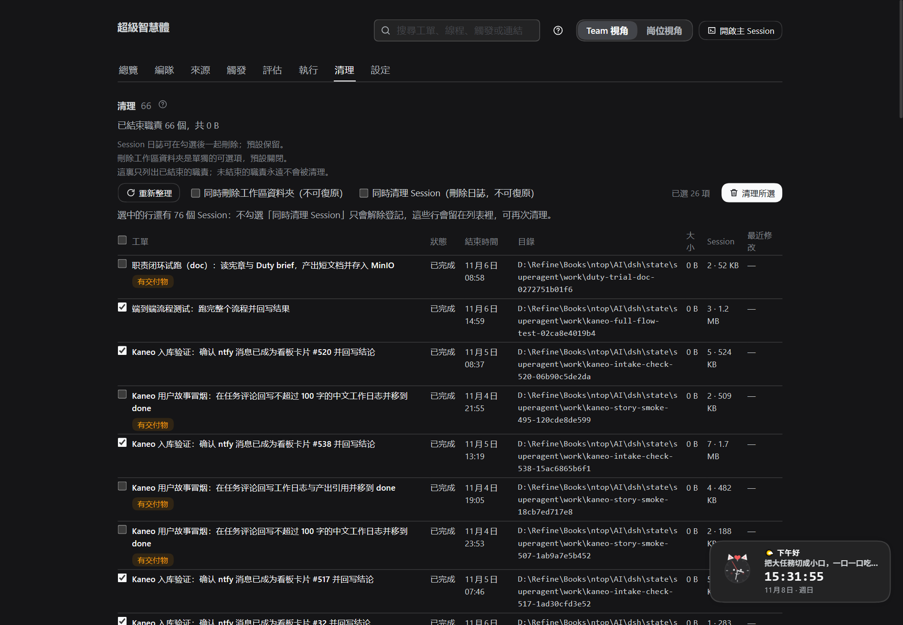

# 010 工作区与 Session 清理

本文说明为什么已结束职责会留下工作区与 Session、清理页列出什么、分别能删什么、以及哪些东西**永远不删**。
执行目录与 Session 的产生见 [003 Execution](003-execution.md)；面板与模块索引见 [007 Architecture](007-architecture.md)。

## 为什么会变多

每个被接受的工单（职责）都会由执行器创建两类东西：

- 一个**工作区目录**：`ticket.execution.directory`，在配置的执行根目录下（默认 `<stateDir>/work`），名字是工单短名加 id 后缀。
- 一份**持久 Session**：`worker-<ticketId>`，由 `sessionPersistence` 落盘；DSH 还会为这个目录写一条 `workspaceRegistry` 登记。

工单结束后二者都不会自动消失：目录仍在磁盘上，Session 日志仍可回放，工作区登记也仍在注册表里。清理页就是"人工确认交付物之后，按需回收这些残留"的地方。

## 清理页列出什么

只列**已结束且仍有残留**的职责：

| 残留 | 是否列出 | 可清理的动作 |
| --- | --- | --- |
| 工作区目录还在 | 是 | 解除登记；可选删目录 |
| 目录没了，但 Session 还在 | 是（原因：`missingDirectory` + `sessionsPresent`） | 可选删 Session |
| 只有登记还在（目录缺失） | 是 | 解除登记 |
| 目录、登记、Session 全都没了 | **否** | 没有可清理的内容，不再占列表 |

因此**清理完成后行会消失**；如果只清了其中一部分（例如只删目录、保留 Session），行会留下并显示剩余项，可以再次清理。旧版本把"目录已消失但没有残留"的工单也列出来且不可清理，这个问题已修复。

*清理页：每行显示目录大小与 Session 数（含大小）；「同时删除工作区文件夹」与「同时清理 Session」是两个独立选项，默认都不勾。*

每行的可清理条件：

1. 工单必须已结束；未结束的职责永远不清理，只在计划里给出原因。
2. 工作区目录没有被其他工单引用：任何未结束职责使用它（`referenced`），或另一个已结束职责也记录它（`shared`），都不清理。
3. 行必须有可做的事：目录存在、有登记、或还有 Session。三者都没有则不属于列表。

默认勾选：可清理且**没有交付物信号**的行。交付物信号来自卡片的 `deliverableType`、`repos`，以及工单自己打开的线程（例如 PR）；带交付物的行默认不勾并标注"有交付物"。

## 两个可选项（默认都关闭）

- **同时删除工作区文件夹**（`removeFiles`）：在路径校验通过后递归删除目录内容，不可恢复。
- **同时清理 Session**（`removeSessions`）：删除这些 Session 的落盘日志，不可恢复。
**Session 的三种状态**：`running`（正在运行）永远拒绝；`idle`（被 DSH 加载但空闲）默认也拒绝并提示"空闲加载"；只有再勾选「**强制清理空闲 Session**」（`forceSessions`）才会删除空闲的那部分。强制删除后，这些 Session 在 DSH 里将不可再打开；工单、卡片与交付物不受影响。

不勾选任何一项时，清理只**解除工作区登记**（让工作区从 DSH 列表消失），目录与 Session 都保留。

## Session 怎么被删除

`sessionPersistence` 没有公开的 delete API，但 JSONL 后端是"一个 Session 一个目录"（日志与锁都在目录内）。清理时宿主：

1. 从 `sessionPersistence.list()` 拿到 Session id、cwd 与 artifact 位置；
2. 只处理 cwd 与工单工作区一致的 Session（即这个工单留下的 Session）；
3. 要求 artifact 位于**以 Session id 命名的目录**内、且文件名形如 `session.*.jsonl(.zstd)`；
4. 跳过仍被宿主加载的 Session（`ctx.agents` 里还注册着它：可能正在运行，也可能只是空闲加载）、没有 artifact 位置的 Session、以及路径不符合上述形状的条目；
5. 删除该 Session 目录。DSH 的搜索索引在下一轮对账时会移除已不存在的 Session，数据库、配置与状态目录不受影响。

拒绝时会说明具体原因：Session 仍被宿主加载（**"正在运行"与"空闲加载"分开显示**）、找不到落盘位置、路径形状不符、或删除文件失败。**"仍被加载"最常见**——在 DSH 会话列表里关闭/删除那个 Session 后，再清理即可（只重启宿主不一定释放：界面会把它重新加载）；如果只想让它从列表消失，直接在 DSH 里删掉会话，下一轮审计就不会再列这一行。

删除失败（例如文件仍被占用）会进入 `skipped` 并给出原因，不会"尽力删除"。

## 清理动作与返回

`POST maintenance/clean` 只处理 `GET maintenance` 计划里 `removable` 的行：

- `removeSessions: true`：删除该工单的 Session（见上）；
- `removeFiles: true`：`checkRemovable` 通过后 `rm(directory, { recursive: true })`；
- 有 `workspaceId` 时总是 `workspaceRegistry.delete(workspaceId)` 解除登记。

返回 `{ cleaned, skipped }`；每项 `cleaned` 带 `filesDeleted`、`workspaceDeleted`、`sessionsDeleted`。不在计划里的 id、未结束职责、被共享的目录、越界路径、删除失败都进入 `skipped` 并带原因码，不会发生任何删除。

## 永远不删

- **未结束的职责**：它们的 worker Session 可能仍在运行，目录是正在写入的现场。
- **运行状态目录**（`stateDir`，含数据库、项目档案、锁）以及任何包含它的路径。
- **执行根目录本身、盘根**，以及执行根目录之外的任何路径。
- **数据库与配置**：Session 删除只动 Session 自己的目录，不写数据库。

## 安全边界

删除目录前，`src/app/maintenance.ts` 的 `checkRemovable` 用 `fs.realpath` 解析目标，并要求：

- 目标是存在的**目录**（不是文件、不是悬空链接）；
- 目标严格位于执行器的执行根目录之下（符号链接按解析后的真实路径判断，指向外部的链接会被拒绝）；
- 目标不是执行根目录本身、不是文件系统根、不等于也不包含 `stateDir`。

路径校验失败只会进入 `skipped`。目录审计按 512 MiB 或 20000 个文件的扫描上限停止统计并标记 `sizeCapped`，面板显示 `≥` 前缀。

## 模块与接口

| 位置 | 作用 |
| --- | --- |
| `src/app/maintenance.ts` | `audit` 汇总残留与安全计划；`clean` 执行计划；`scanWorkspace` 有上限的目录统计；`checkRemovable` 删除路径校验 |
| `src/app/http.ts` | `GET maintenance` 与 `POST maintenance/clean` 路由；Session 删除钩子（`deleteSessions`）从 `sessionPersistence` 与 `workspaceRegistry` 惰性读取 |
| `src/client/maintenance.tsx` | 清理页：按大小降序、默认勾选、两个独立选项（删目录 / 清 Session）与二次确认 |

清理页在 PM 视角可见，岗位视角不显示：工作区是部署级资源，由管理整个项目的人决定去留。
